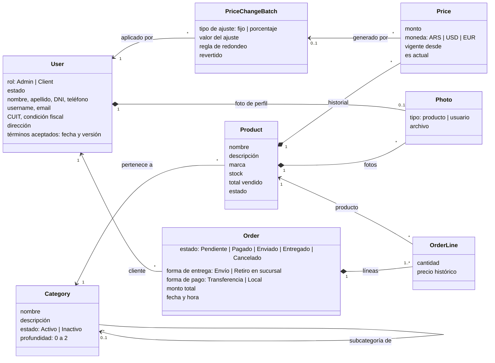

# Propuesta TP DSW

## LAELSI

### Video

[Video demostración](https://drive.google.com/file/d/1qXaOcWWohlrfDlq3GMMrZ0Pog4uzKca6/view?usp=drive_link)

## Grupo

### Integrantes

- 49831 - Nicola, Valentino (com 302)
- 48808 - Ramírez, Facundo (com 302)

### Repositorios

Monorepo: [fullstack app](https://github.com/facumrb/LaElsi)

- [frontend](https://github.com/facumrb/LaElsi/tree/main/fe) (Angular)
- [backend actual](https://github.com/facumrb/LaElsi/tree/main/supabase) (Supabase Edge Functions + PostgreSQL)
- [backend anterior](https://github.com/facumrb/LaElsi/tree/main/be) (Express + MikroORM + MySQL, en desuso)

### Tecnologías

| Capa               | Tecnología                                                                      |
| :----------------- | :------------------------------------------------------------------------------ |
| Frontend           | Angular 21, TypeScript, TanStack Query                                          |
| Backend            | Supabase Edge Functions (TypeScript sobre Deno), API REST                       |
| Base de datos      | PostgreSQL (Supabase) con Row Level Security                                    |
| Autenticación      | Supabase Auth (usuario/email + contraseña y Google OAuth), roles Admin y Client |
| Servicios externos | Cloudflare R2 (imágenes), Resend (correos), Cloudflare Turnstile (anti-bots)    |
| Despliegue         | Vercel (frontend) y Supabase (backend y base de datos)                          |

#### Backend de la regularidad y migración a Supabase

**Hasta la migración, el backend cumplía todos los requisitos técnicos de la cátedra.** El backend `be/` está hecho en TypeScript con Express y tiene:

- una API REST que consume el frontend (`/api/products`, `/api/categories`, `/api/orders`, `/api/clients`, `/api/admins`, entre otras);
- arquitectura en capas: rutas → controlador → servicio → entidad;
- persistencia en MySQL, un servicio externo, a través del ORM **MikroORM**;
- validación de entradas, middlewares de saneamiento y un manejador central de errores que informa por la API;
- login con JWT y dos niveles de acceso (Admin y Client), con las rutas protegidas según el rol;
- configuración por variables de entorno (`.env`);
- dependencias registradas en `package.json`.

El código sigue en el repositorio ([`be/`](https://github.com/facumrb/LaElsi/tree/main/be)) como evidencia y referencia.

**La migración a Supabase se hizo para poder publicar el sistema en internet.** Mantener en línea un servidor Node y una base MySQL tenía un costo que el negocio no podía cubrir. Supabase, Vercel y Cloudflare dan, en sus planes gratuitos, todo lo que el sitio necesita:

- **Despliegue sin servidor propio**: las Edge Functions (TypeScript sobre Deno) y la base PostgreSQL corren en Supabase.
- **Autenticación gestionada**: Supabase Auth resuelve el login con contraseña y con Google, la confirmación y el manejo de sesiones.
- **Seguridad en dos capas**: las escrituras pasan por las Edge Functions, que validan la sesión y el rol, y las políticas RLS de PostgreSQL limitan lo que cada usuario puede leer.

| Requisito técnico del backend | Backend `be/` (regularidad) | Backend actual (Supabase) |
| :-- | :-- | :-- |
| Lenguaje y framework web | TypeScript con Express | Edge Functions (TypeScript sobre Deno) |
| API para el frontend | REST | REST |
| Base de datos como servicio externo | MySQL | PostgreSQL |
| ORM o patrón Repository | MikroORM | Sin ORM: SQL parametrizado y funciones SQL, agrupados por recurso en cada Edge Function (`supabase/functions/<recurso>/`), a la manera del patrón Repository |
| Arquitectura en capas | Rutas → controlador → servicio → entidad | Función → validación → acceso a datos |
| Validación y manejo de errores | Sí | Sí |
| Login con 2 niveles de acceso | JWT con roles Admin y Client | Supabase Auth con roles Admin y Client, y RLS |
| Entornos por variables | `.env` | `.env` de las Edge Functions y `environment.ts` del frontend |

La única diferencia con los requisitos es que el backend actual no usa un ORM.

## Tema

### Descripción

La librería “Laelsi” es un negocio dedicado a la venta de productos de librería, juguetería, computación, imprenta digital y sellos. El sitio web contempla ventas, administración y distribución de pedidos desde cualquier parte de Rosario, con el objetivo de ofrecer y expandir los servicios del negocio a más personas.

### Modelo

## Alcance Funcional

Desde que el cliente entra al sitio web para hacer un pedido hasta que se registran los datos del pedido en el historial de pedidos.

### Alcance Mínimo

Regularidad (cumplida con el backend `be/`):

| Req                     | Detalle                                                                     |
| :---------------------- | :-------------------------------------------------------------------------- |
| CRUD simple             | 1. CRUD Administrador 2. CRUD Categoría                                  |
| CRUD dependiente        | 1. CRUD Producto {depende de} CRUD Categoría                                |
| Listado + detalle | 1. Listados de productos y de categorías; los detalles se ven en el listado |
| CUU/Epic                | 1. Dar de alta un producto                                                  |

Adicionales para Aprobación:

| Req | Detalle |
| :-- | :-- |
| CRUD | 1. CRUD Cliente (datos personales, dirección y datos fiscales) 2. CRUD Administrador 3. CRUD Categoría, con subcategorías de hasta 3 niveles |
| CRUD dependiente | 1. CRUD Producto {depende de} CRUD Categoría (con historial de precios) 2. CRUD Foto {depende de} CRUD Producto y CRUD Usuario 3. CRUD Orden {depende de} CRUD Cliente y CRUD Producto |
| Listado + detalle | 1. Listado de productos de una categoría, filtrado por marca y ordenado por precio (menor a mayor o mayor a menor) o por ventas, con hasta 16 productos por página => detalle del producto 2. Búsqueda de productos por texto, con hasta 16 resultados por página => detalle del producto 3. Listado de los productos más vendidos en la portada, en general y por categoría => detalle del producto 4. Listado de órdenes del panel, filtrado por estado => detalle de la orden con sus líneas y el cliente 5. Listado de órdenes del cliente (historial de pedidos) => detalle de la orden |
| CUU/Epic | 1. Registrarse o iniciar sesión (con contraseña o con Google) y aceptar los términos y condiciones 2. Realizar un pedido: agregar productos al carrito y confirmar la compra, que crea la orden, descuenta el stock y suma las ventas del producto (usa el CUU 1) 3. Gestionar el estado de una orden según la forma de entrega (Pendiente → Pagado → Enviado → Entregado, o Cancelado, que devuelve el stock) (usa el CUU 2) |

### Alcance Adicional Voluntario

| Req | Detalle |
| :-- | :-- |
| Listados | 1. Panel de analíticas: totales, últimas órdenes y ranking de productos más vendidos 2. Carrusel de más vendidos por categoría en la portada |
| CUU/Epic | 1. Recuperar la contraseña con un enlace enviado por email 2. Botón de arrepentimiento (Disp. 954/2025): solicitud sin cuenta, con código de identificación y aviso por email al comercio |
| Otros | 1. Envío de correos automáticos con Resend 2. Protección anti-bots con Cloudflare Turnstile y límites de intentos por IP 3. Cambiar los precios de muchos productos a la vez |
