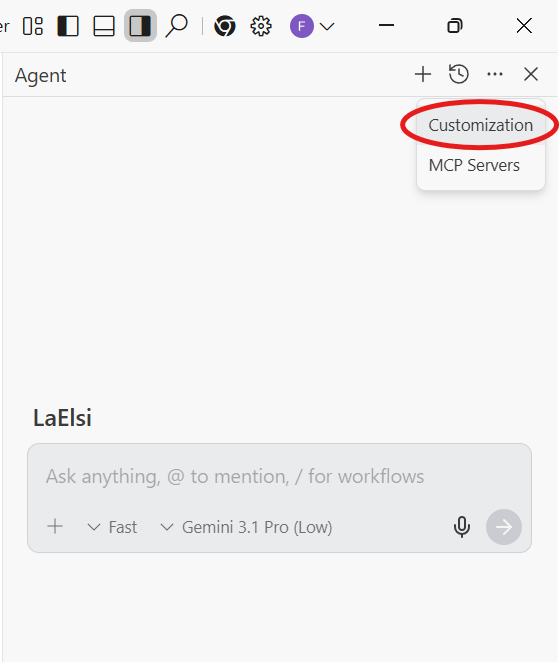
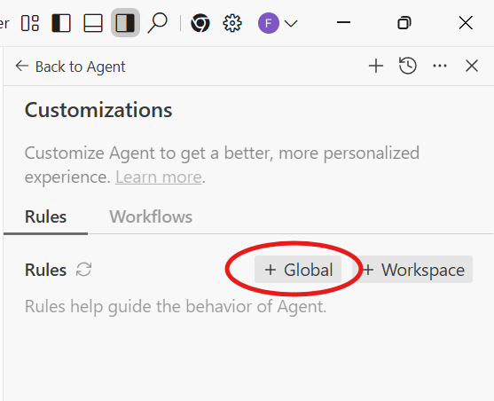
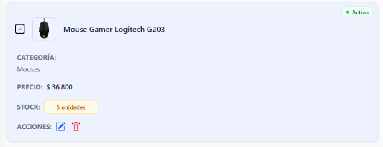

# **Metodología de trabajo:**

- **Reuniones de discord** únicamente para tratar “temas de implementación” como paginación, página de sellos, página de impresión y página de diseño gráfico. También se pueden tratar temas de implementación futura, fechas y hosting.
- **Mensajes en whatsapp:** se debe enviar un mensaje detallado de los cambios que se hayan pusheado con el objetivo de siempre saber qué tareas fueron completadas.
- Establecimiento de prompt para ciertas funciones del sitio: generación a consciencia de prompt considerando contexto del proyecto, seguimiento y corrección de cambios, aceptación con push y revisión de pares.
- Plan de Hosting (ver opciones) y compatibilidad del proyecto para poder ponerlo en línea.

# **Tareas urgentes**

### Al completar las siguientes tareas, ubicar las tareas en el archivo de origen y pasarlas a “Tareas realizadas”.

### **Viene de “Tareas designadas”:**

**(ID: 66\)**  
Conservación de datos ingresados en pantallas de acceso

Si la persona abandona una pantalla de acceso y vuelve a ella dentro de la misma sesión de navegación, la aplicación deberá conservar el identificador ingresado (por ejemplo, nombre de usuario o correo electrónico), siempre que la pantalla no se haya enviado correctamente. La contraseña no deberá almacenarse como borrador por la aplicación.

La pantalla deberá permitir que el navegador o el gestor de contraseñas complete las credenciales mediante los mecanismos estándar de autocompletado. Al volver a la pantalla, el navegador podrá volver a completar la contraseña según su configuración y las preferencias de la persona.

**(ID: 64\)**

Resumen de lo que pide este ID: en cada sección de la página de administración revisar las cards (en pantallas MD o menor) para dividir la información en dos columnas.

Lo prioritario: Organización de cómo se muestran los datos en las tarjetas en distintos tamaños de pantalla del panel de administración.  
Verificar que cada vista del panel de administración mantenga la correcta visualización de las tarjetas, opciones del menú y modales temporales en distintos tamaños de pantalla. Asegurar que los campos de ingreso en las páginas de inicio de sesión y registro estén distribuidos de manera coherente con principios de experiencia de usuario, garantizando legibilidad, accesibilidad y equilibrio visual. Antes de aplicar cambios, identificar qué aspectos de la interfaz requieren ajustes o mejoras para luego definir las acciones de implementación más adecuadas.

Realiza una revisión de diseño adaptable y usabilidad, sin modificar el código.

Recorre todas las vistas del panel de administración y las páginas de inicio de sesión y registro.

Comprueba cada vista en los tamaños de pantalla y dispositivos definidos para el proyecto. En cada caso, revisa que las tarjetas, los menús y los modales se muestren completos, alineados y utilizables, sin desbordamientos ni elementos superpuestos.

En los formularios, evalúa el orden, la alineación y el espaciado de los campos y controles; verifica que las etiquetas, instrucciones y mensajes de error sean legibles y que los controles sean fáciles de identificar y usar.

Registra cada problema indicando la página o vista, el tamaño de pantalla en que aparece, el elemento afectado, el comportamiento observado y su impacto en la legibilidad, accesibilidad o usabilidad.

Para cada problema, propone una acción concreta y priorízala. No implementes cambios hasta que se revise y apruebe el diagnóstico.

**(ID: 62\)**  
Migración del hosting a Supabase al exportar datos actuales usando PostgreSQL, configurar tablas, políticas de acceso y storage, preparar Vercel para que apunte a las APIs y claves de Supabase. Integrar el sistema de autenticación (OAuth2) de Supabase para permitir login con proveedores externos (Google, GitHub, etc.) al configurar los proveedores en el panel de Supabase, ajustar frontend para usar los endpoints de OAuth2 y definir redirecciones seguras y manejo de tokens. Restringir acceso web con Cloudflare limitando por IP, país o autenticación corporativa, bloquear bots o ataques con Firewall y WAF, asegurar el tráfico entre cliente y servidor con SSL/TLS, y evitar abusos de API con Rate Limiting. Preparar Cloudflare, Vercel y Supabase tomando de guía la pestaña “Hosting tareas”.

**(ID: 13\)**  
Actuá como senior developer de un proyecto con frontend y Supabase.

Implementá directamente los cambios necesarios para mejorar la calidad, consistencia, seguridad y performance del proyecto. No esperes aprobación previa para cambios de código, consultas, tipos, manejo de errores o mejoras de mantenibilidad. Realizá los cambios y, al finalizar cada uno, comunicá claramente qué hiciste.

Prestá especial atención a:

1\. Overfetching y underfetching entre frontend y Supabase

\- Eliminá consultas que traen columnas, relaciones o filas que el frontend no utiliza.

\- Agregá los datos faltantes necesarios para evitar requests adicionales, consultas repetidas o estados incompletos en el frontend.

\- Priorizá selects precisos, filtros, paginación, límites y relaciones ya existentes en Supabase.

\- Considerá vistas o RPCs solo cuando una consulta directa sea ineficiente, difícil de mantener o requiera lógica que no deba vivir en el frontend.

\- Antes de crear una vista o RPC, explicá por qué la consulta directa no es suficiente.

\- Mantené compatibilidad con los tipos, componentes y flujos actuales del frontend.

2\. Buenas prácticas y SOLID

\- Aplicá Single Responsibility: separá responsabilidades en componentes, hooks, servicios y funciones cuando corresponda.

\- Aplicá Open/Closed: facilitá la extensión sin modificar lógica existente innecesariamente.

\- Revisá contratos, interfaces y tipos para cumplir Liskov Substitution e Interface Segregation.

\- No abstraigas Supabase por defecto. Aplicá Dependency Inversion solo si facilita tests, permite reemplazar una fuente de datos o reduce duplicación real.

\- Mantené una capa delgada de acceso a datos si el proyecto ya la tiene; no introduzcas repositorios, factories o patrones complejos sin necesidad.

\- Mejorá manejo de errores, validaciones, seguridad, tipado, duplicación y consistencia de patrones.

3\. Frontend y Supabase

\- Alineá los tipos del frontend con el esquema y las respuestas reales de Supabase.

\- Si los tipos se generan desde Supabase, actualizá la generación en lugar de editar tipos generados manualmente.

\- Alineá queries, políticas RLS, estados de carga, errores y autenticación entre ambas capas.

\- Si un cambio altera un contrato compartido, mantené compatibilidad o documentá claramente la migración y los puntos de ruptura.

Orden de ejecución:

1\. Corregí bugs, problemas de seguridad y desalineaciones de datos o contratos.

2\. Optimizá overfetching y underfetching.

3\. Mejorá manejo de errores, estados y validaciones.

4\. Recién entonces aplicá mejoras de SOLID, separación de responsabilidades y reducción de duplicación.

Reglas de implementación:

\- Hacé los cambios necesarios sin pedir aprobación previa, salvo para los casos definidos como de alto riesgo.

\- No introduzcas cambios innecesarios ni refactorices sin motivo técnico claro.

\- Mantené la compatibilidad con el comportamiento existente, salvo que haya un bug, problema de seguridad o inconsistencia que deba corregirse.

\- Si un cambio requiere modificar el esquema, políticas RLS, tipos generados o contratos compartidos, implementalo y documentalo, respetando las restricciones de alto riesgo.

Alcance y restricciones:

\- Limitate exclusivamente a los archivos, módulos, tablas y flujos necesarios para resolver los problemas detectados.

\- No realices refactorizaciones masivas, cambios cosméticos, actualizaciones de dependencias ni migraciones de framework salvo que sean imprescindibles.

\- Mantené compatibilidad con las APIs, rutas, tipos, contratos, flujos y datos existentes. Si un cambio rompe compatibilidad, explicá el motivo, el impacto y la migración requerida.

\- No elimines código, archivos, tablas, columnas o políticas sin documentar el motivo y el impacto.

\- Si una migración de Supabase es necesaria, creá un archivo de migración claro, idempotente cuando sea posible, y documentá cómo aplicarla.

\- No ejecutes ni asumas aplicación automática de migraciones en producción.

\- Para cambios destructivos —borrar tablas, columnas, políticas o cambiar tipos— no los implementes sin confirmación explícita; proponé la migración y su plan de rollback.

Seguridad y calidad:

\- Revisá RLS, autorización, validación de entradas, manejo de sesiones y exposición de claves o datos sensibles.

\- Para cada cambio de RLS, documentá la matriz: rol/actor, operación, tabla, condición y resultado esperado.

\- No amplíes permisos por defecto. Si un cambio de RLS puede afectar acceso existente, implementalo solo si es una corrección de seguridad clara; si implica reducir accesos o cambiar reglas de negocio, reportalo como recomendación antes de aplicarlo.

\- No expongas datos ni operaciones que el usuario autenticado no debería poder acceder.

\- Usá manejo de errores explícito y consistente; evitá silenciar errores.

\- Mantené estados claros de carga, error, vacío y éxito en el frontend.

Después de cada cambio, reportá:

\- Qué se modificó.

\- Por qué era necesario.

\- Archivos creados, modificados o eliminados.

\- Cómo afecta al frontend y/o a Supabase.

\- Cómo verificar el cambio.

\- Posibles efectos secundarios o puntos a revisar.

Verificación:

\- Para cada cambio relevante, indicá cómo probarlo.

\- Si existe una suite de tests, actualizá o agregá tests para los cambios críticos.

\- Si no hay tests, indicá los pasos manuales exactos para validar el comportamiento antes y después del cambio.

Criterio de decisión:

\- Preferí siempre la solución más simple que resuelva el problema correctamente.

\- Si existen varias alternativas, elegí una, explicá brevemente el trade-off y evitá introducir complejidad innecesaria.

\- Si detectás un problema importante fuera del alcance definido, no lo implementes: reportalo como recomendación.

Al finalizar todo, entregá un resumen final con:

\- Lista completa de cambios implementados.

\- Problemas corregidos de overfetching y underfetching.

\- Mejoras de SOLID y buenas prácticas aplicadas.

\- Cambios de seguridad, RLS o migraciones realizados o propuestos.

\- Archivos afectados.

\- Pasos de prueba recomendados.

\- Problemas detectados pero no implementados, con su recomendación.

### **Viene de “Tareas pendientes”:**

**(ID: 43\)**  
Ver e implementar cómo gestionar el cambio de contraseña de un usuario mediante el botón “¿Olvidaste tu contraseña? Se sugiere redirigir a una nueva página “Recuperar contraseña” donde el cliente pondrá su email o DNI (son campos Unique). En esa página al apretar un botón de enviar, se le debe enviar un mail el cual contenga el enlace a una página que tenga 2 inputs (“Contraseña” y “Confirmar contraseña”). Se sugiere utilizar la api de “Resend” ya que tiene un plan gratuito conveniente. [https\://resend.com/](https://resend.com/)

La API de Resend se puede usar de forma adecuada para el flujo de “¿Olvidaste tu contraseña?” de Laelsi, siempre que se limite a enviar el mail con el enlace de reseteo y el backend (“be” y “supabase”) de Laelsi maneje generación/validación del token y el cambio de contraseña.

## **Rol de Resend en el flujo**

Para Laelsi, Resend debe quedar acotado a estas responsabilidades:

- Enviar un mail transaccional al usuario con un link del tipo `https://laelsi.com/reset-password?token=<TOKEN>`.
- Usar su **plan gratuito** para desarrollo y bajo volumen; está pensado justamente para este tipo de casos de prueba y proyectos chicos.
- Integrarse en el backend (por ejemplo Node/Express y Supabase) usando el SDK oficial, no desde el frontend.

Todo lo demás (creación, almacenamiento y validación del token, actualización de la contraseña, controles de seguridad) debe implementarse en el backend (“be” y “supabase”) de Laelsi, siguiendo buenas prácticas tipo OWASP/SuperTokens.

## **Cómo integrar Resend a nivel técnico**

1. Registrar la cuenta de Resend para el dominio de Laelsi y configurar el dominio de envío (DNS, DKIM, etc.) para evitar que los mails de recuperación lleguen a spam.
2. Crear una API key en Resend (panel “API Keys”) y guardarla como variable de entorno en el backend de Laelsi, por ejemplo `RESEND_API_KEY`.
3. Instalar el SDK en el backend: `npm install resend`.
4. Inicializar el cliente en el backend:

`import { Resend } from 'resend';`  
`const resend = new Resend(process.env.RESEND_API_KEY);`

5. En el endpoint “solicitar recuperación” (cuando el usuario ingresa email o DNI):
   - Buscar el usuario por email o DNI (campos únicos como piden los requisitos).
   - Generar un token seguro (aleatorio, de un solo uso, con expiración) y guardarlo en la base de datos asociado al usuario. Las guías recomiendan tokens de un solo uso y con caducidad.cheatsheetseries.owasp+1
   - Construir la URL de reseteo y enviarla con Resend:

``const resetUrl = `https://laelsi.com/recuperar-contraseña?token=${token}`;``

`const { data, error } = await resend.emails.send({`  
 `from: 'Laelsi <no-reply@laelsi.com>',`  
 `to: [usuario.email],`  
 `subject: 'Recuperar tu contraseña',`  
 `` html: ` ``  
 `
Recibimos una solicitud para restablecer tu contraseña.
`  
 `
Hacé clic en el siguiente enlace para establecer una nueva contraseña:
`  
 `
<a href="${resetUrl}">${resetUrl}</a>
`  
 `
Si vos no solicitaste este cambio, podés ignorar este mensaje.
`  
 `` `, ``  
`});`

6. En el endpoint de la página “Recuperar contraseña” (la que tiene los dos inputs “Contraseña” y “Confirmar contraseña”):
   - Validar el token contra la base de datos (vigencia, que no se haya usado, etc.).
   - Si es válido, actualizar la contraseña del usuario (hash \+ sal, según la implementación actual de Laelsi) y marcar el token como usado o eliminarlo.
   - (Opcional) Enviar un mail de confirmación de cambio de contraseña con Resend, reutilizando el mismo cliente y cambiando asunto y contenido.

## **Puntos de seguridad y diseño a considerar**

- No informar explícitamente si un email/DNI existe en el sistema; devolver siempre un mensaje genérico del tipo “Si el usuario existe, te enviamos un correo con instrucciones”. Esto evita la enumeración de usuarios.
- Usar tokens suficientemente largos y aleatorios, y no reutilizarlos; OWASP recomienda enlaces de un solo uso, con expiración corta (ej. 1 hora).
- No poner la nueva contraseña directamente en el mail; solo debe ir el enlace para que el usuario defina la contraseña en el sitio.
- Mantener separado el front (páginas “¿Olvidaste tu contraseña?” y “Recuperar contraseña”) del backend que usa Resend y gestiona tokens y contraseñas.

## **Conclusión para la tarea**

- La descripción funcional que tenés (botón “¿Olvidaste tu contraseña?”, página “Recuperar contraseña” con email o DNI, mail con enlace, página con “Contraseña” y “Confirmar contraseña”) es coherente con las buenas prácticas generales de flujos de recuperación.
- Resend encaja bien como servicio de envío de emails transaccionales para este flujo en Laelsi, aprovechando su SDK oficial y plan gratuito; se usa únicamente para enviar el mail de recuperación y (opcionalmente) el mail de confirmación, mientras que toda la lógica sensible reside en el backend de Laelsi.

**“Tareas pendientes”**

**(ID: 65\)**  
Mostrar una ventana modal cuando el usuario intente eliminar una entidad del sistema. La ventana debe advertir que la eliminación física puede generar errores si la entidad está vinculada a otros procesos o elementos del negocio. En lugar de eliminarla definitivamente, se debe recomendar realizar una desactivación lógica o marcarla como inactiva, preservando su integridad y evitando impactos en operaciones relacionadas. El mensaje debe ser claro, preventivo y orientado a buenas prácticas de mantenimiento de datos.

**(ID: 67\)**  
Ventanas modal que deberían realizarse para una mejor UI:

- En la pestaña del pedido, al apretar el botón “Confirmar pedido”.
- Al terminar de realizar el pedido debería saltar otro modal.
- Dentro de un cliente, yendo al perfil del cliente, al darle al botón de “cambiar contraseña”.

**(ID: 68\)**  
Si soy administrador, ¿puedo realizar un pedido? Actualmente no se puede, porque salta un toast diciendo “no se encontró el cliente” y me invalida la solicitud.  
Quizá hay un escenario donde el admin quiere realizar el pedido en nombre de otra persona y el backend debería aceptar su solicitud.

En caso de que el admin no pueda realizar pedidos, lo mejor seria realizar lo siguiente:

- Deshabilitar o quitar el botón de agregar al carrito dentro de los productos.
- Del navbar del ecommerce quitar el carrito
- Deshabilitar la página de pedidos.

**(ID: 69\)**  
Revisar si vale la pena tener la pagina view-profile para el administrador. Quiza con la pagina edit-profile ya es suficiente puesto que actualmente no cumple una verdadera función la pagina view-profile.

**(ID: 70\)**  
Actualmente el rendimiento (performance) de cada página está en un 60%. El mismo puede verse dentro de F12 en la app Lighthouse.  
Por lo tanto, se deben evaluar formas de mejorar la performance de cada una.  
Ejemplo de cosas que se pueden hacer:

- Hacer componentes esqueletos para cada página. De esta forma la página al cargarse ya sabe de antemano donde va colocado cada componente y no tiene que adivinar su posicionamiento.
- utilizar el decorador @defer.

**(ID: 71\)**  
Actualmente el cliente al ser creado tiene como campos obligatorios:

- Nombre de usuario
- Mail
- Contraseña

Entonces quizá sería conveniente quitar la obligatoriedad de otros campos en el formulario de creación de clientes dentro del panel de administrador.

**(ID: 73\)**  
Modificar la interfaz y la lógica del carrito de compras para incluir controles de selección (como checkboxes) en cada ítem. Esto permite al cliente elegir explícitamente qué productos desea incluir en el proceso de pago actual, separando el "contenido total del carrito" de la "orden de compra a procesar".

Esto permite que el cliente pueda utilizar el carrito como una lista de espera. Si el presupuesto no le alcanza en ese momento o prefiere postergar una adquisición, puede simplemente desmarcar el producto y comprar el resto. El ítem no seleccionado permanece guardado en el carrito para futuras sesiones sin obligarlo a buscarlo nuevamente en el catálogo.

Además, esto evita la frustración de obligar al usuario a eliminar productos deseados de su carrito únicamente para poder avanzar con el pago de los ítems prioritarios.

**Implementación** (ID: 54\)  
Posibilidad de establecer un producto como "Publicación Pausada" desde el panel de administración, ya que es útil poder pausar una publicación aunque tenga stock. La utilidad está en que el stock refleja disponibilidad física, mientras que la publicación refleja disponibilidad comercial.

**(ID: 77\)**  
Corregir un error de accesibilidad: cuando las cards de productos son seleccionadas los textos CATEGORÍA, PRECIO, STOCK y ACCIONES no se distinguen correctamente del fondo.  
  
Creo que se puede arreglar desde el archivo styles.css en la linea:  
.admin-table-mobile-label {  
 @apply font-bold uppercase text-gray-500;  
 }  
Donde el text-gray debería ser de 600 para distinguirse bien.

# **Tareas urgentes**

### Al completar las siguientes tareas, ubicar las tareas en el archivo de origen y pasarlo a “Tareas realizadas”.

### **Viene de “Tareas pendientes”:**

**(ID: 42\)**  
Autenticación en dos pasos para usuarios nuevos e ingreso en dispositivo sin credenciales guardadas. Agregar una palabra secreta como atributo en la entidad de cliente para la recuperación de contraseña.

### **Viene de “Implementaciones de mejora”:**

**(ID: 21\)**  
Un producto puede ser de varios colores (tienen el mismo precio) o de diferentes tamaños (considerando las tres dimensiones: cm, cm2 y cm3 con diferentes largos cada lado). Ejemplo: afiche rojo 70x100cm.  
Quizá el color y el tamaño no es lo único que podría diferir, puede que también sea la marca, si es importado o ecológico.  
Será necesaria una clase para “color” que tenga atributo nombre (de color), cantidad, stock… averiguar según los datos actuales del producto. Será necesario un nuevo atributo llamado “tamaño” de tipo string.

**(ID: 55\)**  
Cuando se selecciona cantidad en el producto seleccionado, debe aparecer la posibilidad de eliminar en conjunto toda la cantidad que se seleccionó. Actualmente, para sacar la selección de un producto, hay que presionar “-” la cantidad de veces que se presionó “+”.

## **Próximo “(ID: X)”, X \= 79**

## **Tareas de Facu:**

- [ ] Revisar shared/[forms.utils.ts](http://forms.utils.ts) del frontend y verificar que las validaciones estén completas para cada caso de los atributos de las entidades que las necesiten. Encontrar validaciones del mismo tipo en otros archivos y pasarlos a este archivo para centralizar la función. Esta es solo la capa de frontend, ¿qué conviene con las demás capas (backend y base de datos)? (ID: 4\)

- [ ] El orden de visualización de las categorías no debe tener máximo. Actualmente el máximo es 3 y debería ser variable a la cantidad de categorías o no tener máximo. (ID: 34\)

- [ ] Definir qué es y cómo hacer el histórico de precios, ver qué datos son importantes incluir en el histórico, y aplicar los cambios que luego serán útiles en las estadísticas. Además, cada vez que se cambie el precio de un producto, ¿cómo es la lógica para que se guarde una instancia para el histórico de precios? Es necesario implementar una visualizador del historial de precios de un producto en específico según sea seleccionado. (ID: 6\)

- [ ] Hacer un Code Review con Claude Opus (con la última versión del momento) para que mencione todos los cambios que deben hacerse. Una vez entendidos y documentados los cambios, dar el visto bueno para que Claude lleve a cabo los cambios. Incluir la corrección de Overfetching y Underfetching para compatibilizar mejor entre frontend y backend. (ID: 13\) \- Lo hace Facundo únicamente.

- [ ] En cuanto a las validaciones del username del Administrador y Cliente, ver si es conveniente de que no existan 2 usuarios con el mismo username. (ID: 61\)

- [ ] Migración del hosting a Supabase al exportar datos actuales usando PostgreSQL, configurar tablas, políticas de acceso y storage, preparar Vercel para que apunte a las APIs y claves de Supabase. Integrar el sistema de autenticación (OAuth2) de Supabase para permitir login con proveedores externos (Google, GitHub, etc.) al configurar los proveedores en el panel de Supabase, ajustar frontend para usar los endpoints de OAuth2 y definir redirecciones seguras y manejo de tokens. Restringir acceso web con Cloudflare limitando por IP, país o autenticación corporativa, bloquear bots o ataques con Firewall y WAF, asegurar el tráfico entre cliente y servidor con SSL/TLS, y evitar abusos de API con Rate Limiting. Preparar Cloudflare, Vercel y Supabase tomando de guía la pestaña “Hosting tareas”. (ID: 62\)

## **Tareas de Valen:**

- [x] ~~Corroborar que cada vista en diferentes tamaños de pantalla se pueda ver cada card de cada opción del navbar del panel de administrador de forma que la información esté bien distribuida y que responda a lo que se sabe de UX. (ID: 64\)~~
- [ ] Permitir que en cada formulario se guarde temporalmente la información ingresada por el usuario en caso de que el mismo decida cambiar de página y luego volver a la página del formulario. (ID: 66\)

# **Dificultad Baja**

-

# **Dificultad Media**

- Hacer un histórico de vida de cada producto con los datos de la auditoría: desde que es creado, cada vez que es actualizado (mencionando los cambios que se hicieron) y cada vez que pasa de activo a inactivo y viceversa. (ID: 41\)

- Autenticación en dos pasos para usuarios nuevos e ingreso en dispositivo sin credenciales guardadas. Agregar una palabra secreta como atributo en la entidad de cliente para la recuperación de contraseña. (ID: 42\)

- Ver e implementar cómo gestionar el cambio de contraseña de un usuario mediante el botón “¿Olvidaste tu contraseña? Se sugiere redirigir a una nueva página “recuperar contraseña” donde el cliente pondrá su email o DNI (son campos unique). En esa página al apretar un botón de enviar, se le debe enviar un mail el cual contenga el enlace a una página que tenga 2 inputs (“Contraseña” y “Confirmar contraseña”). Se sugiere utilizar la api de “Resend” ya que tiene un plan gratuito conveniente. [https\://resend.com/](https://resend.com/) (ID: 43\)

- Mostrar una ventana modal para evitar eliminar entidades de forma física y, en su lugar, aconsejar de que desactive de forma logica la entidad. Ya que una entidad puede estar conectada a procesos elementos del negocio y traeria errores su eliminación. (ID: 65\)

# **Dificultad Alta**

- Implementar página “Impresiones” en el E-commerce. (ID: 44\)

- Implementar página “Diseño Gráfico” en el E-commerce. (ID: 45\)

- Implementar página “Sellos” en el E-commerce. (ID: 46\)

- Para las compras realizadas mediante transferencia se debería integrar la API de Mercado Pago, de modo que se genere automáticamente un enlace con el precio cargado, se crucen los datos entre el pago recibido en la cuenta del negocio y la cuenta del cliente en Laelsi, y finalmente se actualice de forma automática el estado del pedido a “Pagado” siempre que la verificación de datos sea correcta. (ID: 49\)

# **Tareas Realizadas por Facu:**

- Implementar en el backend un manejador de errores centralizado

- Implementar estandarización de respuestas HTTP.

- Reimplementar `BaseEntity` para que tenga los atributos: `ID`, `createdAt`, `updatedAt`, `deletedAt`.

- Implementar entidad pedido (`order`)

- Ver que entidades requieren el atributo ‘estado’ de activo o inactivo para reflejar la propiedad `deletedAt`.

- Selección múltiple de productos para cambiarles el precio (puede ser sumar o restar un monto o un porcentaje). Se necesitaría un checkbox en el front para seleccionar los productos. Esto debe ser hecho en el panel cuando se ingresa como administrador.

- Agregar en el backend un enum para los Métodos de Pago. Basarse en order.model.ts, usar los métodos de pago que aparecen ahí. Aclarar que si es en local puede ser efectivo, tarjeta de débito/crédito.

- Rediseñar el perfil del administrador logueado. Una opción es tomar de base el formulario de administrador de crear/editar un admin.

- Desarrollar un método asíncrono en los controladores de cada entidad para verificar la disponibilidad de campos `UNIQUE` (email, username, etc) antes del envío del formulario. De esta forma mientras el usuario escribe, se puede ir validando si está disponible o no este campo en lugar de recibir un error cuando hace submit.

- Acceder al pedido de la sección pedidos del panel de administrador para poder ver toda la información. (Sin ID)

- Agregar al archivo de enum de backend un enum para los métodos de pago. Basarse en order.model.ts, usar los métodos de pago que aparecen ahí. Aclarar que si es en local puede ser efectivo, tarjeta de débito/crédito. (ID: 2\)

- Desarrollar un método asíncrono en los controladores de cada entidad para verificar la disponibilidad de campos `UNIQUE` (email, username, etc) antes del envío del formulario. De esta forma mientras el usuario escribe, se puede ir validando si está disponible o no este campo en lugar de recibir un error cuando hace submit. (ID: 3\)

- Ordenar el backend siguiendo buenas prácticas. (ID: 29\)

- En la creación de producto, si no hay una categoría que corresponda, se debe permitir crear una nueva categoría directamente desde el formulario de producto, guardando temporalmente los datos ingresados en caché para evitar pérdidas y retomando luego el formulario con la nueva categoría seleccionada y los campos intactos. (ID: 7\)

- Se debería introducir un campo `order` de tipo numérico en la entidad Categoría, para definir la posición de cada categoría en el navbar del e‑commerce. Este orden debería poder establecerse desde el admin-panel. (ID: 8\)

- Se extiende el modelo de categorías para soportar jerarquías mediante un `parent_id` con integridad referencial, exponiendo subcategorías en la API y el panel administrativo con validaciones y UI anidada, mientras el frontend gestiona breadcrumbs, filtros y menús jerárquicos, contemplando rendimiento, SEO, migraciones reversibles, pruebas y documentación para asegurar una integración segura y mantenible. (ID: 9\)

- Si un producto no tiene stock, se muestra con mensaje Agotado.  
  Si un producto se desactiva y el cliente accede por su historial de pedido, se muestra con mensaje Publicación Pausada.  
  Si se desactiva un producto, este no aparece en Más Vendidos, buscador o categorías. (ID: 40\)

- Al agregar al carrito un producto desde cualquier interfaz donde se vea el producto a agregar, se debe mostrar cuántas unidades se están agregando del producto, visible en el producto (al lado o algún lugar cerca). (ID: 14\)  

- Implementar en admin-panel en el form de Cliente y Administrador dos inputs, “Contraseña” y “Confirmar contraseña” los cuales deben coincidir (se debe validar tanto desde el front como el backend). El administrador tiene el privilegio de cambiar contraseñas sin saberlas. (ID: 56\)  

- Implementar en client-panel en el perfil del cliente un boton “Cambiar contraseña”, el cual primero le pide la contraseña actual, si es correcta le muestra dos inputs “Contraseña” y “Confirmar contraseña” (se debe validar tanto desde el front como el backend). (ID: 57\)

- Realizar Formulario de Register-Page. El mismo debe contemplar: formularios reactivos, validación de datos (form.utils.ts, datos duplicados), reactividad (signals), manejo de errores, vistas (SM, MD, LG). Además añadir el icono de ojo para tapar/ver la contraseña. Utilizar admin-form como ejemplar para construir a mano el register-page. (ID: 5\)

- Implementar mecanismos de caché para las imágenes ya visualizadas. Esto evitará descargas repetidas, reduciendo así el consumo de datos de la aplicación. Se recomienda el uso de “**TanStack query**” y Service Worker para realizar esta implementación.  
  [https\://tanstack.com/query/latest/docs/framework/angular/installation](https://tanstack.com/query/latest/docs/framework/angular/installation)

# **Tareas Realizadas por Valen:**

- Hacer el Login: guard de rutas, validación de datos (duplicados, http, etc), regex, reactividad, manejo de errores, vistas (SM, MD, LG).

- form.utils.ts debe validar que no entren solo espacios vacíos.

- Íconos SVG a “boostrap icon” para simplificar el código.

- Rediseñar el botón “Filtros” dentro de las categorías del E-commerce. Se debe quitar los colores violetas y se debe mejorar el seleccionable “Filtrar por marca”.

- Dentro del Perfil de un Cliente, se debe revisar el formulario (validators, responsividad y accesibilidad). Se debe agregar el componente de la foto de usuario.

- Rediseñar la pestaña de Pedidos en el Admin-panel:
  - Agregar un botón de Filtros para filtrar entre los distintos estados del pedido según el Enum OrderState.

- Rediseñar la pestaña de Clientes en el Admin-panel:
  - Agregar un botón de Filtros para filtrar entre los distintos estados del pedido según el Enum OrderState.

- Agregar un mensaje de “Enviar comprobante de pago por Whatsapp” en caso de que el pago sea por Transferencia.

- Mejorar la velocidad de búsqueda de productos de la Barra de búsqueda del E-commerce.

- Permitir el acceso a la información de un pedido desde la lista de pedidos del dashboard.

- Al entrar en un pedido en el panel de administrador, se trabaja en el mismo en el negocio, por eso sería útil que en el mismo pedido haya al lado del mail y del número de teléfono un botón (ícono tanto de email como de WhatsApp) de redirección para contactarse con el cliente para cada dato.

- Cambiar la palabra “Dashboard” por “Analíticas”.

- El archivo environments del fe ahora tiene una constante que maneja la dirección y puerto del backend.

- Cuando se ingresa a editar una categoría, un producto, etc. dice “CREADO EL”, “ACTUALIZADO EL”, y ahora se pretende el siguiente funcionamiento para lo que antes era “ELIMINADO EL”:  
  Debe decir “ACTIVO DESDE” o “INACTIVO DESDE” según si la instancia (categoría, producto, etc) está con estado activo o inactivo, y mostrar la fecha en la que se llevó a cabo el cambio de estado. Ejemplo:  
  Estado: Inactivo, entonces… “INACTIVO DESDE 23/02/2026 22:46”. (ID: 33\)

- Implementar un middleware en el backend para convertir las imágenes que se carguen en Webp. (ID: 47\)

- Implementar un servicio, o una función dentro del servicio correspondiente, para eliminar automáticamente los espacios en blanco que existan a los costados de un texto ingresado en un Input de algún formulario o campo donde se ingrese texto. (ID: 30\)

- Al poner un menos (-) en la actualización de precio, lo considera como carácter no válido, debe permitirlo. Que no lance el mensaje de alerta si se pone un menos (-), validar tanto desde el backend como desde el frontend. Lanzar el mensaje sólo si se presiona enter y no hay número ingresado, o si se ingresa otro carácter que no sea menos (-), más (+), porcentaje (%) o número (incluye la coma (,) para decimal). (ID: 36\)

- (ID: 35\) Al confirmarse un pedido, debe aparecer el siguiente mensaje:

                          **¡Pedido realizado\!**

  Tu pedido ha sido creado correctamente. Realiza el pago al alias laelsi.libreria.mp. Recuerda enviar el comprobante a nuestro Whatsapp: \+54 9 3417121860

  Es necesario que la parte “Tu pedido ha sido creado correctamente.” cambie por “Tu pedido se ha recibido correctamente.”

- (ID: 15\) Para el ordenamiento de categorías, se sugiere la siguiente implementación:
  - Eliminar la columna “Orden”.
  - Agregar un botón en la Toolbar llamado “Ordenar categorías”.
  - Al ser presionado este botón, dispara una ventana modal que lista las categorías con estado activo.
  - Dichas categorías tienen la funcionalidad de drag and drop para posicionarlas en el orden en que quieran ser visualizadas.
  - Si hubiera subcategorías: al lado de cada categoría principal habría un icono que despliega las subcategorías, las cuales también podrían ser ordenadas de la misma manera.

- Verificar e implementar que las subcategorias no se muestren en el navbar cuando su estado es “Inactivo”. (ID: 58\)

- Si de una categoría se cambia el estado de “Inactivo” a “Activo” debe salir un alert informando que “una categoría no debe estar Activa si no tiene productos activos”. (ID: 59\)

- (ID: 1\)  
  Agregar métodos de paginación para todas las entidades que las necesiten, considerando las diferentes vistas (SM, MD, LG), considerando que hay diferentes filtros también.  
  Se recomienda paginar de a 16 productos (es el estándar en ecommerce). A continuación se marca las tareas que se deben hacer:

- Ya que van a ser 16 productos se recomienda en las cards de productos actualizar los grid para especificar la cantidad de cards a mostrar sm:2, md: 3 y lg:4.
- Analizar y agregar métodos de paginación en los métodos del backend de cada entidad. Se debe considerar que la paginación debe agregarse también a los métodos de filtrado de datos.
- En el E-commerce la paginación debe estar implementada en cada categoría y dentro del perfil de un cliente los pedidos deben estar paginados.  
  Añadir paginación en el Admin-panel: Administradores, Clientes, Categorías, Productos y Pedidos.

# **IMPLEMENTACIONES DE MEJORA**

### **Implementación** (ID: 10\)

Reestructurar la carpeta Uploads del backend:  
/uploads  
│  
├── /userPhotos \<-- Unificación de fotos de perfil de usuarios  
│ ├── /admins \<-- Solo perfiles con rol de Administrador  
│ └── /clients \<-- Perfiles de Clientes (Consumidor Final, RI, etc.)  
│  
└── /productPhotos \<-- (Anteriormente categoryPhotos)  
 ├── /Electrónica \<-- Carpeta autogenerada por nombre de Categoría  
 │ ├── iphone-15.webp  
 │ └── mouse-logitech.webp  
 │  
 ├── /Librería \<-- Carpeta autogenerada por nombre de Categoría  
 │ ├── cuaderno-a4.webp  
 │ └── lapicera-bic.webp  
 │  
 └── /... \<-- Otras categorías dinámicas

### **Implementación** (ID: 11\)

En cada producto, si no hay stock, debería aparecer el botón de reservar.

### **Implementación** (ID: 12\)

Para las compras por Transferencia, se debería utilizar la API de MercadoPago.  
La idea sería:

- Generación automática del enlace a Mercado Pago con precio cargado.
- API de Mercado Pago para cruzar datos entre el pago que llega al Mercado Pago del negocio y la cuenta del cliente en Laelsi.
- Actualización automática del Estado del pedido a “Pagado” en caso de que los datos sean correctos.

Se recomienda ver las siguientes webs:  
[admin-pay.galio.app](https://admin-pay.galio.app/)  
[https\://github.com/goncy/next-mercadopago](https://github.com/goncy/next-mercadopago)

### **Implementación** (ID: 17\)

En el carrito, selección de productos para borrar en grupo o realizar un pedido. Actualización en tiempo real del pedido al seleccionar productos.

### **Implementación** (ID: 26\)

Agregar el autocomplete correspondiente a los Inputs para ahorrar tiempo a los usuarios que usan formularios.

### **Implementación** (ID: 27\)

Los productos del modal de pedido deben ser otro modal. En el pedido se muestra solo una cantidad pequeña de los productos seleccionados. Si los productos son pocos, entonces se muestran todos. Si son muchos, se muestra un botón de “Ver más" para abrir el modal donde aparecen en forma de registros todos los productos del pedido.

### **Implementación** (ID: 63\)

Desde el panel de administrador, tanto en lo que se muestra en el pedido como en el modal de productos, se debe poder marcar con un “tick” cada producto para que el administrador lleve cuenta de qué productos están listos para la entrega (dichos “ticks” quedan registrados si la app se cierra o el administrador se pone a hacer otra cosa). Al hacer “tick” en un producto, aparece un mensaje temporal que informa que el producto está listo.

### **Implementación** (ID: 18\)

Agregar un botón apretable en los toast de éxito, por ejemplo al terminar de editar un producto, que tenga el texto “Deshacer cambios” en caso de que se quiera revertir los cambios hechos. Esto es aplicable para muchos contextos donde se edite algo. Se debe informar al administrador qué cambios se hicieron, y así el mismo pueda decidir si hubo algún error, el mensaje debe ser suficientemente comunicativo con un lapso temporal adecuado (ej: 5/10 segundos) de tal forma que haya tiempo de revertir los cambios.

### **Implementación** (ID: 19\)

En los productos del Ecommerce debe quedar reflejado el valor del artículo sin impuestos.

### **Implementación** (ID: 20\)

Dado que el token de sesión se expira, investigar qué conviene hacer para no corromper el uso continuo de la aplicación por caducación de token.

### **Implementación** (ID: 21\)

Un producto puede ser de varios colores (tienen el mismo precio) o de diferentes tamaños (considerando las tres dimensiones: cm, cm2 y cm3 con diferentes largos cada lado). Ejemplo: afiche rojo 70x100cm.  
Quizá el color y el tamaño no es lo único que podría diferir, puede que también sea la marca, si es importado o ecológico.  
Será necesaria una clase para “color” que tenga atributo nombre (de color), cantidad, stock… averiguar según los datos actuales del producto. Será necesario un nuevo atributo llamado “tamaño” de tipo string.

### **Implementación** (ID: 22\) Esta implementación está en espera de confirmación por parte del negocio:

Para los productos que quedan desactualizados a corto plazo (ejemplo: calendarios y agendas), se puede programar tanto en negocio como en sistema, una forma para despacharlos sin perder dinero.

**Implementación** (ID: 23\)  
Pestaña en navbar del panel de administrador para cambiar el aspecto visual o estético del ecommerce en su totalidad, el cual se le muestra al cliente. Ejemplo: ícono del negocio, color del navbar en donde se ven las categorías, etc.

**Implementación** (ID: 24\)  
Al actualizarse el precio de algún producto que el cliente tiene guardado en el carrito de compras, debe notificarse por modal al cliente al momento de actualización o cuando entra al ecommerce. En el carrito, dicho en el producto correspondiente, debe mostrarse un mensaje que menciona que el mismo tuvo actualización de precio. La actualización de precio y su correspondiente aviso debe darse únicamente si el producto en el carrito ya pasó los 5 minutos de haber sido seleccionado. Los productos no seleccionados se actualizan al instante, y si el cliente está en una página y el producto fue actualizado en cuanto al precio entonces el mismo se actualiza pasados los 5 minutos.  
Al confirmar el pedido, el sistema debe corroborar que el precio de cada producto haya sido establecido, como mínimo, pasado los 5 minutos de estadía en el carrito. Si el cliente presiona “Confirmar pedido” antes de esos 5 minutos, entonces se le muestra un modal que advierte los cambios de precio, y muestra la opción de Ver cambios o Aceptar cambios.

### **Implementación** (ID: 25\) Implementación incompleta:

Actualmente aparece un botón de “Actualizar precio” al momento de seleccionar un producto o varios en el panel en la sección de productos. Este botón debe ser reemplazado por uno que diga “Actualizar”, el mismo debe aparecer siempre que haya, o no, sido seleccionado un producto. Si se presiona el botón “Actualizar” y no hay producto seleccionado, entonces aparece un mensaje temporal que informa que debe seleccionarse uno o más producto. El botón debe cambiar su aspecto si hay o no producto seleccionado. En caso de que el botón esté habilitado, se abre un modal con todos los tipos de actualización como navbar a la izquierda (actualizar precio, stock, etc) y por cada tipo, puede haber diferentes tipos de actualización. Ejemplo: precio tiene actualización por cantidad y porcentaje. Tarea: estudiar qué tipos de actualización habrá y cómo se lleva a cabo cada uno.

### **Implementación** (ID: 32\)

En el pedido que ve el cliente en su perfil debe aparecer, por cada orden, un botón de Whatsapp y Email para comunicarse con un administrador y así poder resolver cualquier inquietud con respecto al pedido. Al administrador se le envían, adjunto al mensaje que puede agregar el cliente, un enlace al pedido y un mensaje por defecto.

### **Implementación** (ID: 37\)

Averiguar si con API de ARCA puede haber carga de cuit/cuil automática.

### **Implementación** (ID: 38\)

Si el pedido es cancelado por el cliente, mostrar de alguna forma en Pedidos del panel que fue cancelado por el cliente y que se pueda ver el último estado del pedido al entrar al mismo. Esto es necesario para saber que el pedido fue cancelado por el cliente, para saber cuándo fue cancelado, y en qué estado estaba el pedido antes de ser cancelado (trazabilidad).

### **Implementación** (ID: 39\)

Agregar un atributo nombre-descripcion para el producto, se hace una función que toma dicho atributo y le agrega el precio del producto, se busca alguna manera para que el ambos datos se muestren en un rectángulo (un rectángulo por producto) y se exporta para impresión. Esto permite automatizar la impresión para poner precio a los productos en el local.

### **Implementación** (ID: 50\) En el servidor del ecommerce se integra Gemma de Google como asistente.

- Si el usuario es **cliente**, la IA funciona como chatbot para responder dudas y acompañar la experiencia de compra.
- Si el usuario es **administrador**, la IA cambia de rol y ayuda en el análisis del negocio con información relevante.

### **Implementación** (ID: 51\) Se utiliza **OpenClaw** o derivado (ej: NemoClaw) para gestionar las respuestas de **WhatsApp**.

- Atiende mensajes de clientes de forma automática.
- Permite **exportar archivos** que los clientes envían, integrándolos al flujo de trabajo del negocio.

### **Implementación** (ID: 52\)

Al finalizar la compra enviar una encuesta de satisfacción por mail al cliente.

### **Implementación** (ID: 53\)

Agregar un lugar donde el cliente pueda enviar dudas, escribir comentarios o reseñas.

### **Implementación** (ID: 72\)

Incorporar atributos de texto libre en la entidad “Pedido” para registrar aclaraciones y/o requerimientos extras. Se sugiere implementar dos campos separados para organizar la información y mantener la privacidad de la gestión:

- **Notas del Cliente (Público):** campo opcional habilitado durante el proceso de compra. Le da libertad al comprador para detallar indicaciones de envío o requerimientos específicos sobre los productos (ej. "Enviar los componentes de la PC ya ensamblados").

- **Notas Internas (Admin):** campo de uso exclusivo para la administración. Permite al vendedor documentar información post-venta, recordatorios o acuerdos charlados por otros canales (ej. por WhatsApp \| Gmail)

### **Implementación** (ID: 74\)

Implementar el patrón de "eliminación lógica" en la base de datos (por ejemplo, añadiendo un atributo `fecha_eliminacion` a los registros). En lugar de realizar un borrado físico, las entidades simplemente se ocultan de las vistas principales de la aplicación y pasan a listarse en un nuevo panel administrativo llamado "Entidades Eliminadas" o "Papelera".

Esto es distinto al estado “inactivo” ya existente. Ponerlo en Inactivo tiende a pausar una publicación o entidad, pero no implica un borrado. Por eso, se deberían agregar dos propiedades nuevas en las entidades `fecha_eliminacion` y `estado_eliminado`.

### **Implementación** (ID: 75\)

Configurar una restricción en la cantidad máxima que un cliente puede seleccionar de un mismo artículo. Si el usuario intenta superar este tope, el sistema bloqueará el incremento y mostrará una alerta (notificación o tooltip) indicando que, para compras de mayor volumen, debe concretar el pedido actual y contactarse por WhatsApp para coordinar el excedente.

### **Implementación** (ID: 76\)

Implementar una etiqueta visual dinámica en la interfaz de cada artículo del carrito que muestre el inventario restante (ej: "¡Solo quedan X unidades en stock\!"). Este mensaje se activará automáticamente solo cuando la cantidad disponible del producto caiga por debajo de un umbral mínimo predefinido.

Tener en cuenta que se debe reservar de antemano el espacio estructural para este texto en la viñeta del artículo. De esta forma, se evita que la aparición condicional del mensaje desplace los demás elementos y altere la maquetación de la viñeta del artículo.

### **Implementación** (ID: 79\)

Crear una Subpestaña llamada “Marcas” dentro de la pestaña “Productos” en el admin-panel. La idea sería tener un abanico de marcas, y poder crearlas segun sea necesario.

De esta manera, al crear un producto nuevo, se selecciona una marca que ya exista en el comercio, o se crea una nueva. Similar a como ocurre con el select de la categoría.

Esto resuelve el problema de que por accidente se creen 2 marcas iguales pero que tienen un nombre parecido.

Investiga en sitios web oficiales en caso de ser necesario, utiliza el proyecto como contexto. Te paso información ya investigada:

Firebase es una **plataforma de desarrollo de aplicaciones** creada por Google que ofrece un conjunto de servicios en la nube para facilitar la construcción y gestión de apps móviles y web. Vercel es una **plataforma de despliegue en la nube** pensada principalmente para aplicaciones web modernas. Su enfoque está en simplificar el proceso de pasar del desarrollo local a la producción global, con infraestructura optimizada para velocidad y escalabilidad. Supabase es una **plataforma backend open source** que busca ser una alternativa moderna a Firebase, pero construida sobre **PostgreSQL**. Su idea es que puedas crear aplicaciones completas sin tener que montar ni gestionar infraestructura complicada.

**Pros de migrar BE a Firebase y FE a Vercel:**

1\. Infraestructura totalmente gestionada

- No administro servidores, contenedores ni despliegues manuales.
- Firebase maneja escalado automático, seguridad y disponibilidad.

## 2\. Integración muy fluida para frontends modernos

- Vercel despliega el FE en segundos.
- Firebase ofrece SDKs muy fáciles de consumir desde el FE.

## 3\. Reducción de costos iniciales

- Firebase tiene un tier gratuito generoso.
- Vercel también tiene un plan free muy útil para proyectos pequeños/medianos.

## 4\. Backend simplificado

Si el backend es principalmente:

- autenticación
- CRUD
- lógica ligera
- triggers
- notificaciones
- almacenamiento de archivos

Firebase lo resuelve muy bien.

## 5\. Despliegues rápidos y CI/CD integrado

- Push a main → FE se despliega en Vercel.
- Push a funciones → BE se despliega en Firebase.

# **Contras y limitaciones importantes:**

## 1\. Firebase NO es un backend tradicional

Si el backend actual usa:

- Express con middlewares complejos
- WebSockets persistentes
- Procesos largos o intensivos
- Jobs programados pesados
- Integraciones complejas con terceros
- Bases SQL relacionales

…entonces Firebase puede quedarse corto o requerir reescritura profunda.

2\. Vendor lock‑in

Firebase usa:

- Firestore (NoSQL propietario)
- Cloud Functions con sintaxis propia
- Reglas de seguridad específicas

Migrar fuera de Firebase después puede ser costoso.

## 3\. Configuración distribuida

Tendré:

- Config FE en Vercel
- Config BE en Firebase
- Variables de entorno separadas
- Logs separados
- Deploy pipelines separados

Esto aumenta la complejidad operativa.

## 4\. Latencia entre FE (Vercel) y BE (Firebase)

No suele ser un problema, pero:

- Vercel → edge network
- Firebase → regiones específicas

Si no elijo bien la región, puede haber latencia perceptible.

## 5\. Lógica backend limitada por el modelo serverless

Cloud Functions:

- tienen timeout
- no permiten procesos persistentes
- no permiten sockets abiertos por mucho tiempo
- no permiten acceso directo al sistema de archivos (solo temporal)

# ¿Cuándo SÍ conviene esta arquitectura?

\- El backend es simple o puede reescribirse como funciones serverless  
 \- Mi base de datos puede ser NoSQL  
 \- Mi frontend es moderno (React/Next.js)  
 \- Quiero despliegues rápidos y sin mantenimiento  
 \- Mi proyecto no requiere lógica pesada ni procesos largos

# ¿Cuándo NO conviene?

\- Mi backend usa lógica compleja o intensiva  
 \- Necesito SQL relacional  
 \- Tengo WebSockets persistentes  
 \- Necesito control total del servidor  
 \- Mi proyecto crecerá hacia microservicios o arquitectura compleja

# Conclusión:

Sí, es posible que un proyecto funcione con:

- Backend \+ configs en Firebase
- Frontend \+ configs en Vercel

Pero solo es una buena decisión si el backend encaja en el modelo serverless.  
 Si el backend actual es complejo, probablemente necesite reescribir partes importantes.

La clave es entender qué parte del backend actual puede migrar a Firebase y qué parte no, lo mismo con el frontend a Vercel.

Existe la posibilidad de usar Supabase, te paso las diferencias con Firebase para evaluar usar Supabase como reemplazo debido a las dificultades de migración y dependencia.

**Diferencias clave Firebase vs. Supabase como BE:**

\- Base de datos:  
Firebase usa Firestore (NoSQL, escalable pero propietario).  
Supabase usa PostgreSQL (SQL relacional, más flexible para queries complejas, joins, pero menos auto-escalado nativo).

\- Autenticación:  
Ambos ofrecen Auth similar (email, social logins).  
Supabase es más extensible con Row Level Security (RLS) en SQL.

\- Funciones:  
Firebase con Cloud Functions (Node.js/Python/Go, serverless con timeouts).  
Supabase con Edge Functions (Deno, más ligeras, globales, pero menos maduras para lógica pesada).

\- Almacenamiento:  
Firebase Storage (simple, integrado).  
Supabase Storage (similar, pero con mejor integración SQL para metadatos).

\- Realtime:  
Firebase excels con sincronización push (Firestore listeners).  
Supabase usa Realtime sobre PostgreSQL (bueno, pero no tan optimizado para apps de alto volumen).

\- Costo y Vendor Lock-in:  
Firebase: Tier gratuito generoso, pero lock-in alto (APIs propietarias); migración costosa por reescritura de reglas/funciones/Firestore.  
Supabase: Open-source, self-hostable (menos lock-in), costos similares pero egress más baratos; migración más fácil a otros SQL.

\- Escalabilidad:  
Firebase: Totalmente gestionado, auto-escalado global.  
Supabase: Gestionado pero enfocado en edge, menos regiones; requiere más config para escala masiva.

\- Integraciones:  
Firebase: Fuerte con Google ecosystem (Analytics, ML).  
Supabase: Mejor para stacks open-source, integra con Vercel/Next.js fácilmente.

\- Limitaciones:  
Firebase: NoSQL limita relacionales complejos.  
Supabase: SQL mejor para datos estructurados, pero realtime menos eficiente en grandes datasets.

Para un setup con simple CRUD/auth/storage:  
Supabase reduce lock-in y soporta SQL si necesito relacional, pero evalúa si se prefiere NoSQL. Complejidad migración similar, pero Supabase permite exportar datos más fácilmente.

**Cuándo conviene Supabase:**

\- Conviene: Apps con datos relacionales (PostgreSQL), menos vendor lock-in (open-source, self-hostable), integración con stacks modernos como Next.js/Vercel, realtime eficiente sobre SQL, costos predecibles para egress bajo.

\- No conviene: Apps que requieren NoSQL puro (como Firestore), escalabilidad masiva auto-gestionada sin config, lógica serverless pesada (Edge Functions menos maduras), o ecosistema Google (Analytics, ML).

**Comparación planes gratuitos:**

Firebase Spark (plan gratuito).

- Base de datos: Firestore con 1 GiB de almacenamiento, 50.000 lecturas por día y 20.000 escrituras por día.
- Funciones: 2 millones de invocaciones al mes y 400.000 GB-segundos.
- Autenticación: Usuarios ilimitados, hasta 50.000 MAUs.
- Almacenamiento: 5 GB de almacenamiento; descargas de 1 GB/día (legacy) o 100 GB/mes.
- Tiempo real: Incluido en Firestore.
- Transferencia/Egreso: 10 GiB/mes en Firestore y 5 GB/mes en Functions.
- Otros: Hosting con 10 GB de almacenamiento; Test Lab con 60 minutos/día en dispositivos virtuales.

Supabase Free (plan gratuito).

- Base de datos: PostgreSQL con 500 MB de tamaño, solicitudes API ilimitadas.
- Funciones: 500.000 invocaciones.
- Autenticación: Usuarios ilimitados, hasta 50.000 MAUs.
- Almacenamiento: 1 GB de almacenamiento, con un máximo de 50 MB por archivo subido.
- Tiempo real: 200 conexiones simultáneas y 2 millones de mensajes al mes.
- Transferencia/Egreso: 5 GB de egreso.
- Otros: Retención de logs por 1 día; soporte comunitario.

**Consideraciones para el sistema de almacenamiento de multimedia:**

1\. Banners

- Pesan mucho si son grandes
- Se sirven constantemente
- Conviene CDN

### 2\. Imágenes de productos

- El mayor peso del proyecto
- Muchas imágenes, alta resolución
- Necesitan optimización \+ CDN

### 3\. Fotos de perfil de usuarios

- Peso bajo, pero volumen alto si hay muchos usuarios

### 4\. Archivos para impresión (subidos por clientes)

- Pueden ser PDF, PNG, JPG de alta calidad
- Pueden pesar entre 1 MB y 50 MB
- Necesitan almacenamiento temporal

### 5\. Reportes analíticos

- CSV, JSON, PDF
- Peso bajo a medio
- No se sirven al público, solo al admin

### 6\. Logs y backups

- A veces olvidados
- Pueden crecer mucho si no se gestionan

### 7\. Videos (si algún día agregás)

- Peso altísimo
- Requieren storage especializado

**Imágenes y archivos pesados → Cloudflare R2**

    Cloudflare R2 → prácticamente gratis

- 0 costo por egress (esto es enorme: Firebase, AWS y Supabase sí cobran por salida).
- Almacenamiento muy barato (10 GB gratis por mes).
- CDN global incluido si usás Cloudflare Images o Workers.

###

###

### **Archivos temporales (ej: impresiones) → Cloud Run \+ R2 bucket temporal**

### Cliente → Cloud Run (Python) → R2 (bucket temporal)

1. ## Cloud Run

- recibe el archivo
- valida tamaño, tipo, usuario
- lo sube a R2
- genera una URL temporal para el admin
- borra el archivo después de X horas/días

2. ## R2 bucket temporal

- almacenamiento barato
- sin costo por servir el archivo al admin
- podés borrar automáticamente con lifecycle rules

# ¿Por qué Cloud Run es necesario en el medio?

Porque no quiero que el cliente suba directamente a R2. Si lo hiciera:

- no podés validar tamaño
- no podés validar tipo
- no podés validar usuario
- no podés evitar que suban archivos maliciosos
- no podés controlar el flujo
- no podés generar URLs seguras
- no podés borrar automáticamente según lógica de negocio

**Orden de prioridad** para el impacto inmediato sobre el peso de transferencias de multimedia:

1. **Transformación de tipo de archivo para imágenes** (usar WebP/AVIF, imágenes responsivas con `srcset`) → mayor impacto en peso total.
2. **Lazy loading y carga diferida** (imágenes y scripts solo cuando se necesitan) → evita transferencias innecesarias.
3. **Mantener en caché archivos ya descargados** (políticas claras de expiración y validación en navegador/servidor) → reduce descargas repetidas.
4. **Compresión de archivos (Gzip/Brotli)** → disminuye tamaño de HTML, CSS y JS en cada request.
5. **Paginación inteligente** (cargar lo justo y necesario) → limita transferencias en catálogos grandes.
6. **Minificación y bundling de CSS/JS** → menos solicitudes y menor peso.
7. **CDN para recursos estáticos** → baja latencia y mejora velocidad global.
8. **Imágenes responsivas y adaptadas al dispositivo** → evita servir archivos más pesados de lo necesario.
9. **Optimización de fuentes (WOFF2, subset de caracteres)** → reduce peso en tipografías.
10. **Pre‑fetching y pre‑loading** → anticipa recursos críticos para mejorar percepción de velocidad.
11. **Uso de HTTP/2 o HTTP/3** → mejora transferencia paralela y eficiencia en conexiones.

### **Nota**

Los primeros cinco puntos suelen dar el **mayor retorno inmediato** en reducción de peso y experiencia de usuario. Los siguientes complementan y optimizan aún más, especialmente en proyectos con alto tráfico o catálogos extensos.

Luego de todas estas consideraciones y habiendo analizado el proyecto, ¿qué usaremos?

# **📊 Análisis de Migración: Laelsi → Firebase / Supabase \+ Vercel**

## **🔍 Lo que encontré en el proyecto**

### **Backend (Express \+ MikroORM \+ MySQL)**

| Componente            | Descripción                                                                         | Impacto en migración           |
| :-------------------- | :---------------------------------------------------------------------------------- | :----------------------------- |
| ORM                   | MikroORM con MySQL, relaciones complejas                                            | 🔴 Muy alto                    |
| Modelo de datos       | Relacional con STI (Single Table Inheritance en User), Foreign Keys, joins anidados | 🔴 Muy alto                    |
| Historial de precios  | Price con isCurrent, validFrom, batch, lógica de rollback                           | 🔴 Difícil en NoSQL            |
| Transacciones         | ACID en órdenes (stock \+ totalSold \+ items en un solo flush)                      | 🔴 Muy alto                    |
| Auth propia           | JWT custom con bcrypt, roles (Admin/Client), middleware verifyToken/ verifyRole     | 🟡 Reemplazable                |
| Paginación            | findAndCount SQL nativo                                                             | 🟡 Reemplazable                |
| Auditoría             | AuditLog con FK a User, JSON details                                                | 🟡 Reemplazable                |
| Multer \+ disco local | Guarda imágenes en uploads/products y uploads/users                                 | 🔴 Incompatible con serverless |
| Seed \+ syncSchema    | Inicialización al arrancar el servidor con datos y migración automática             | 🟡 Reemplazable                |
| Bulk price update     | Lógica de ajuste masivo, rollback por lote, auditoría                               | 🟡 Cloud Function viable       |

### **Frontend (Angular 21\)**

| Componente                    | Estado para Vercel                                                |
| :---------------------------- | :---------------------------------------------------------------- |
| Angular SPA                   | 🔴 Vercel SÍ soporta Angular, pero sin SSR nativo (no es Next.js) |
| Angular SSR                   | No está configurado, es CSR puro                                  |
| HttpClient \+ interceptor JWT | 🟢 Compatible con cualquier backend                               |
| Signals                       | 🟢 Angular moderno, sin problema                                  |
| Lazy loading de rutas         | 🟢 Funciona en Vercel como SPA                                    |
| Assets estáticos              | 🟢 Vercel los sirve perfecto                                      |

---

## **🔴 Los problemas reales de migrar este backend**

### **1\. El modelo relacional está fuertemente acoplado**

El backend usa relaciones SQL reales que son muy difíciles de mapear a NoSQL:

User (STI: Admin \| Client)

└── UserPhoto (OneToOne)

└── Order (OneToMany)

      └── OrderLine (OneToMany → Product)

Product

└── Category (ManyToOne)

└── Price\[\] (historial, isCurrent, batch FK)

└── ProductPhoto\[\] (con order de visualización)

PriceChangeBatch

└── Price\[\] (para rollback)

└── AuditLog

En Firestore no existen joins. Cada consulta como

findBestSellers (que filtra state \+ category.state, ordena por totalSold, con prices\[isCurrent\]) requeriría múltiples roundtrips o desnormalizar todo el modelo.

### **2\. Las transacciones ACID son críticas en órdenes**

Cuando se crea una orden:

typescript

product.stock \-= item.quantity;

product.totalSold \+= item.quantity;

order.addItem(product, quantity, currentPrice);

em.flush(); // todo o nada

En Firestore las transacciones existen, pero están limitadas a 500 documentos y tienen una complejidad mayor. En Cloud Functions el timeout (540 seg max) sería suficiente, pero la lógica de rollback de precios es más difícil de garantizar.

### **3\. Multer escribe al sistema de archivos — incompatible con serverless**

typescript

// Esto NO funciona en Cloud Functions ni Edge Functions

multer.diskStorage({ destination: 'uploads/products/...' })

fs.unlink(filePath);

app.use('/uploads/products', express.static(...));

Las Cloud Functions no tienen sistema de archivos persistente. Cada invocación tiene

/tmp efímero con solo 256MB a 32GB según tier. Esto requiere reescritura completa del sistema de imágenes.

### **4\. El historial de precios no encaja en NoSQL**

La entidad Price es una tabla de auditoría con:

- isCurrent para saber el precio vigente
- validFrom para historial temporal
- batch FK para agrupar cambios masivos
- Lógica de rollback que desactiva registros e identifica el "precio anterior más reciente"

En Firestore habría que hacer esto con subcolecciones y consultas adicionales, perdiendo atomicidad.

### **5\. STI (Single Table Inheritance) en User**

typescript

@Entity({ discriminatorColumn: 'dtype' })

abstract class User { ... }

class Admin extends User { ... }

class Client extends User { ... }

Firestore no tiene concepto de herencia de colecciones. Se puede emular con un campo

type, pero toda la lógica ORM de MikroORM desaparece y hay que reescribir manualmente.

---

## **📊 Veredicto: ¿Firebase o Supabase?**

### **Para el backend: Supabase gana claramente**

| Criterio                            | Firebase                                 | Supabase                                             | Ganador  |
| :---------------------------------- | :--------------------------------------- | :--------------------------------------------------- | :------- |
| Modelo de datos actual (relacional) | ❌ Firestore es NoSQL, reescritura total | ✅ PostgreSQL, migración natural                     | Supabase |
| STI de User                         | ❌ Emulación manual                      | ✅ PostgreSQL hereda STI posible                     | Supabase |
| Historial de precios \+ rollback    | ❌ Muy difícil en documentos             | ✅ Tablas relacionales normales                      | Supabase |
| Transacciones ACID                  | ⚠️ Limitadas a 500 docs                  | ✅ PostgreSQL completo                               | Supabase |
| Auth JWT actual                     | ⚠️ Reemplazar con Firebase Auth          | ⚠️ Reemplazar con Supabase Auth                      | Empate   |
| Lock-in                             | 🔴 Alto (Firestore propietario)          | 🟡 Bajo (PostgreSQL \= exportable)                   | Supabase |
| Migración de datos                  | 🔴 Reescritura total del modelo          | 🟢 Migración de MySQL a PostgreSQL mucho más directa | Supabase |
| Edge Functions (lógica custom)      | ✅ Cloud Functions maduras               | ⚠️ Edge Functions (Deno) menos maduras               | Firebase |
| Plan gratuito DB                    | 1 GiB Firestore                          | 500 MB PostgreSQL                                    | Firebase |

### **Para el frontend: Vercel es perfectamente viable**

Angular como SPA funciona en Vercel sin problemas. El ng build genera archivos estáticos que Vercel sirve con CDN global. No tenés SSR configurado actualmente, así que no perderías nada. La única diferencia notable sería configurar el vercel.json para redirigir todas las rutas al index.html (comportamiento SPA).

### **Para almacenamiento de imágenes: Cloudflare R2 es la opción correcta**

El análisis que ya tenías es exacto. R2 tiene egress gratuito, lo que lo hace superior a Firebase Storage y Supabase Storage para un catálogo de imágenes de productos.

---

## **🗺️ Arquitectura recomendada**

┌─────────────────┐ ┌─────────────────────┐ ┌──────────────────┐

│ Angular SPA │───▶│ Supabase Backend │ │ Cloudflare R2 │

│ (Vercel CDN) │ │ │ │ (Imágenes) │

│ │ │ ✅ PostgreSQL │◀──▶│ \- /products/ │

│ \- Lazy routes │ │ ✅ Supabase Auth │ │ \- /users/ │

│ \- HttpClient │ │ ✅ Edge Functions │ │ \- /banners/ │

│ \- Signals │ │ ✅ RLS policies │ │ 0 costo egress │

└─────────────────┘ │ ✅ Realtime (SQL) │ └──────────────────┘

                      └─────────────────────┘

---

## **📋 ¿Qué partes del backend migran bien y cuáles no?**

### **🟢 Migra directamente (bajo esfuerzo)**

| Funcionalidad                      | Equivalente en Supabase                 |
| :--------------------------------- | :-------------------------------------- |
| Autenticación (login/register/JWT) | Supabase Auth — drop-in replacement     |
| CRUD de categorías                 | Supabase PostgreSQL — mismas queries    |
| CRUD de productos (básico)         | Supabase PostgreSQL — esquema igual     |
| Paginación                         | PostgreSQL LIMIT/OFFSET — igual a MySQL |
| Guards de rol (Admin/Client)       | Row Level Security (RLS) — más elegante |
| AuditLog                           | Tabla PostgreSQL — misma estructura     |
| Enums (ProductState, OrderState)   | PostgreSQL ENUM — soporte nativo        |

### **🟡 Migra con refactoring moderado**

| Funcionalidad                    | Qué cambia                                                                                                  |
| :------------------------------- | :---------------------------------------------------------------------------------------------------------- |
| Historial de precios \+ rollback | Las tablas quedan igual, pero la lógica de PriceChangeBatch pasa a Edge Function                            |
| Ordenes con validación de stock  | Transacción PostgreSQL en Edge Function — viable                                                            |
| Bulk price update                | Edge Function de Supabase — lógica portable                                                                 |
| Sistema de imágenes (Multer)     | Reemplazar con Supabase Storage o Cloudflare R2 \+ presigned URLs                                           |
| STI de User (Admin/Client)       | En PostgreSQL se mantiene casi igual, sin discriminatorColumn de MikroORM pero con una columna dtype manual |

### **🔴 Requiere reescritura significativa**

| Funcionalidad | Por qué es difícil |
| :-- | :-- |
| MikroORM completo | Hay que reemplazarlo. Con Supabase usarías el Supabase JS client o Drizzle ORM (que soporta PostgreSQL y tiene buena integración con Supabase) |
| Multer \+ sistema de archivos local | Incompatible con serverless. Reemplazar con R2 presigned upload URLs |
| Express app como servidor persistente | Supabase Edge Functions son stateless. El seedDatabase() al arrancar, el syncSchema(), el RequestContext de MikroORM — todo cambia |
| app.use('/uploads/...', static()) para servir imágenes | La imagen se sirve desde R2/CDN, no desde el backend |

---

## **💸 ¿Qué será costoso salir de Supabase después?**

Aunque Supabase tiene mucho menos lock-in que Firebase, migrar fuera de Supabase en el futuro implicaría:

1. Migrar PostgreSQL → es un dump SQL estándar. Costo: bajo — cualquier proveedor PostgreSQL lo acepta (Railway, Neon, PlanetScale vía adapter, AWS RDS, etc.)
2. Supabase Auth → los usuarios son propios de Supabase. Migrar las contraseñas es imposible (están hasheadas por Supabase). Costo: alto — usuarios tendrían que resetear contraseñas o migrar a un nuevo sistema pidiendo re-login.
3. Edge Functions (Deno) → son TypeScript estándar con sintaxis Deno. Portar a Node.js/Express es directo. Costo: bajo
4. Supabase Storage → si usás R2 para imágenes, este problema no existe. Costo: cero
5. RLS Policies → son SQL estándar de PostgreSQL. Funcionan en cualquier PostgreSQL. Costo: bajo

_El verdadero lock-in de Supabase es Supabase Auth (cuentas de usuarios). Todo lo demás — la DB, las funciones, el storage — es fácil de portar._

---

## **✅ Recomendación final**

Usar: Supabase (BE) \+ Vercel (FE) \+ Cloudflare R2 (storage)

### **Razones:**

1. El modelo de datos es relacional, con joins, FKs, historial y transacciones. PostgreSQL de Supabase lo soporta nativamente. Firebase lo rompería todo.
2. El esfuerzo de migración es 3–4× menor con Supabase porque no tenés que cambiar el modelo de datos, solo el ORM y la plataforma de ejecución.
3. Cloudflare R2 elimina el problema del sistema de archivos local y el costo de egress.
4. Angular en Vercel es completamente viable como SPA estática.
5. El lock-in de Supabase es mínimo — la base de datos es PostgreSQL estándar exportable en cualquier momento.

### **El mayor trabajo de la migración será:**

- Reemplazar MikroORM/Express por Supabase JS Client \+ Edge Functions (o mantener un pequeño servidor Node en Railway/Fly.io si querés evitar reescribir toda la lógica de ORM)
- Reemplazar Multer \+ disco local por presigned URLs hacia Cloudflare R2
- Reemplazar JWT custom por Supabase Auth

La tabla original \- Backend (Express \+ MikroORM \+ MySQL) \- evaluaba el impacto en la migración de forma genérica (apuntando principalmente a Firebase). Con Supabase el panorama cambia bastante. Acá va la comparación:

---

## **Tabla original (con Firebase como destino)**

| Componente            | Descripción                                                    | Impacto en migración           |
| :-------------------- | :------------------------------------------------------------- | :----------------------------- |
| ORM                   | MikroORM con MySQL, relaciones complejas                       | 🔴 Muy alto                    |
| Modelo de datos       | Relacional con STI, Foreign Keys, joins anidados               | 🔴 Muy alto                    |
| Historial de precios  | Price con isCurrent, validFrom, batch, lógica de rollback      | 🔴 Difícil en NoSQL            |
| Transacciones         | ACID en órdenes (stock \+ totalSold \+ items en un solo flush) | 🔴 Muy alto                    |
| Auth propia           | JWT custom con bcrypt, roles (Admin/Client), middleware        | 🟡 Reemplazable                |
| Paginación            | findAndCount SQL nativo                                        | 🟡 Reemplazable                |
| Auditoría             | AuditLog con FK a User, JSON details                           | 🟡 Reemplazable                |
| Multer \+ disco local | Guarda imágenes en uploads/products y uploads/users            | 🔴 Incompatible con serverless |
| Seed \+ syncSchema    | Inicialización al arrancar con datos y migración automática    | 🟡 Reemplazable                |
| Bulk price update     | Ajuste masivo, rollback por lote, auditoría                    | 🟡 Cloud Function viable       |

---

## **Tabla actualizada (con Supabase como destino)**

| Componente | Descripción actual | Impacto con Supabase | Equivalente / Detalle |
| :-- | :-- | :-- | :-- |
| ORM (MikroORM) | MikroORM con MySQL, entidades decoradas, flush/persist | 🟡 Moderado | Reemplazar por Drizzle ORM o Supabase JS Client. El esquema de entidades cambia, pero los conceptos son los mismos. La mayor pérdida es el RequestContext y el sistema de decoradores. |
| Modelo de datos relacional | STI, FKs, joins, OneToMany, ManyToOne | 🟢 Bajo | PostgreSQL de Supabase soporta todo esto nativamente: FKs, joins, índices. El schema ALTER TABLE migra casi 1:1 desde MySQL. Solo pequeñas diferencias de sintaxis. |
| STI (Single Table Inheritance) | User con Admin/ Client y columna dtype | 🟡 Moderado | PostgreSQL soporta herencia de tablas, pero MikroORM lo manejaba automáticamente. Sin el ORM, hay que gestionar la columna dtype manualmente o usar tabla separada por tipo (más limpio en SQL puro). |
| Historial de precios | Price con isCurrent, validFrom, batch, rollback | 🟢 Bajo | Las tablas quedan idénticas en PostgreSQL. La lógica de rollback pasa a una Edge Function o función SQL/stored procedure en Supabase. |
| Transacciones ACID | Órdenes: stock \+ totalSold \+ items en un solo flush() | 🟢 Bajo | PostgreSQL tiene transacciones ACID completas sin límite de documentos. En Edge Functions se usa supabase.rpc() con una función SQL que envuelve todo. |
| Auth propia (JWT \+ bcrypt) | Middleware verifyToken/ verifyRole, JWT propio | 🟡 Moderado | Reemplazar con Supabase Auth. Los usuarios existentes necesitan migración (las contraseñas hasheadas con bcrypt deben resetearse). Los roles se implementan con PostgreSQL RLS (Row Level Security) o un claim custom en el JWT de Supabase. |
| Paginación | findAndCount() de MikroORM | 🟢 Bajo | Se traduce directamente a LIMIT / OFFSET en PostgreSQL. Supabase JS Client tiene .range(from, to) como equivalente directo. |
| Auditoría | AuditLog con FK a User, campo JSON details | 🟢 Bajo | Tabla PostgreSQL idéntica. El tipo jsonb de PostgreSQL es incluso más potente que el json de MySQL (indexable, consultable). |
| Multer \+ disco local | Escribe en uploads/products/, sirve con express.static() | 🔴 Alto | Incompatible con serverless independientemente de la plataforma. Hay que reemplazar con Cloudflare R2 (presigned URLs para upload, CDN para servir). Este trabajo es el mismo con Firebase o Supabase. |
| Seed \+ syncSchema | seedDatabase() y updateSchema() al arrancar el servidor | 🟡 Moderado | syncSchema se reemplaza con migraciones SQL (Supabase tiene un sistema de migraciones propio). El seed se ejecuta una vez manualmente vía CLI de Supabase o como script SQL. |
| Bulk price update \+ rollback | Ajuste masivo de precios con auditoría y reversión por lote | 🟢 Bajo | Lógica portable casi directa a una Edge Function de Supabase. Toda la lógica es algebraica (porcentajes, redondeo) sin dependencia del disco. |
| Búsquedas con filtros complejos | findBestSellers filtra por estado de producto \+ categoría, ordena por totalSold, solo precio actual | 🟢 Bajo | SQL nativo de PostgreSQL lo resuelve con un simple JOIN \+ WHERE \+ ORDER BY. Más eficiente que el ORM. |

---

## **Resumen del cambio de panorama**

| Indicador                           | Con Firebase                                                    | Con Supabase                                                          |
| :---------------------------------- | :-------------------------------------------------------------- | :-------------------------------------------------------------------- |
| Componentes con impacto 🔴 Alto     | 4 (modelo datos, STI, historial precios, transacciones, Multer) | 1 (solo Multer — incompatible con serverless en cualquier plataforma) |
| Componentes con impacto 🟡 Moderado | 5                                                               | 4                                                                     |
| Componentes con impacto 🟢 Bajo     | 1                                                               | 6                                                                     |

El mensaje es claro: el modelo de datos de Laelsi ya es relacional y encaja naturalmente en PostgreSQL. El esfuerzo de migración con Supabase es mayormente de herramienta (cambiar MikroORM, cambiar Auth, cambiar el sistema de archivos), no de rediseño arquitectónico. Con Firebase el rediseño arquitectónico del modelo de datos sería inevitable y costoso.

# **Lista completa de tareas para migrar Laelsi a Supabase \+ Vercel \+ Cloudflare R2**

# **Las tareas están organizadas en bloques por área y ordenadas por dependencia lógica.**

---

## **BLOQUE 0 — Preparación y cuentas**

### **Tarea 0.1 — Crear cuenta y proyecto en Supabase**

# **Ir a [supabase.com](https://supabase.com/) y crear una organización y un proyecto nuevo. Anotar los siguientes valores del panel de Supabase (Project Settings → API):**

- # **SUPABASE_URL → URL del proyecto (ej: https\://xxxx.supabase.co)**

- # **SUPABASE_ANON_KEY → clave pública (para el FE)**

- # **SUPABASE_SERVICE_ROLE_KEY → clave privada con permisos totales (solo para el BE / Edge Functions, nunca exponerla en el FE)**

### **Tarea 0.2 — Crear cuenta en Cloudflare y configurar R2**

1. # **Ir a [cloudflare.com](https://cloudflare.com/) y crear una cuenta.**

2. # **Activar R2 Object Storage (requiere agregar tarjeta, pero el almacenamiento es gratuito hasta 10 GB).**

3. # **Crear dos buckets:**
   - # **laelsi-products → para fotos de productos**

   - # **laelsi-users → para fotos de perfil de usuarios**

4. # **En cada bucket, configurar acceso público (desde Settings → Public Access → Allow Access). Esto genera una URL base del tipo https\://pub-xxxx.r2.dev.**

5. # **Crear un API Token de R2 con permisos de lectura/escritura (My Profile → API Tokens → Create Token → R2 Storage → Edit). Guardar:**
   - # **R2_ACCOUNT_ID**

   - # **R2_ACCESS_KEY_ID**

   - # **R2_SECRET_ACCESS_KEY**

   - # **R2_PUBLIC_URL_PRODUCTS → URL pública del bucket de productos**

   - # **R2_PUBLIC_URL_USERS → URL pública del bucket de usuarios**

### **Tarea 0.3 — Crear cuenta en Vercel y conectar el repositorio**

1. # **Ir a [vercel.com](https://vercel.com/) y crear una cuenta (se puede vincular con GitHub/GitLab).**

2. # **Importar el repositorio del proyecto.**

3. # **Configurar el proyecto apuntando a la carpeta fe/ como root del proyecto Angular.**

4. # **Todavía no hacer deploy — primero hay que actualizar el código del FE.**

# ---

## **BLOQUE 1 — Base de datos en Supabase (Schema SQL)**

### **Tarea 1.1 — Crear el schema SQL completo en Supabase**

# **En el SQL Editor de Supabase, ejecutar el siguiente schema que traduce todas las entidades del proyecto. Este reemplaza el**

# **syncSchema() de MikroORM:**

# **sql**

# **\-- ENUMS**

# **CREATE TYPE user_role AS ENUM ('Admin', 'Client');**

# **CREATE TYPE category_state AS ENUM ('Activo', 'Inactivo');**

# **CREATE TYPE product_state AS ENUM ('Activo', 'Inactivo');**

# **CREATE TYPE order_state AS ENUM ('Pendiente', 'Pagado', 'Enviado', 'Entregado', 'Cancelado');**

# **CREATE TYPE delivery_method AS ENUM ('RetiroSucursal', 'Envio');**

# **CREATE TYPE fiscal_condition AS ENUM ('ConsumidorFinal', 'ResponsableInscripto', 'Monotributista', 'Exento');**

# **CREATE TYPE currency AS ENUM ('ARS', 'USD');**

# **CREATE TYPE photo_type AS ENUM ('product_photo', 'user_photo');**

# **CREATE TYPE adjustment_type AS ENUM ('fixed', 'percentage');**

# **\-- BASE: columnas comunes (reemplaza CustomBaseEntity)**

# **\-- No se crea tabla, se agregan las columnas en cada tabla.**

# **\-- USUARIOS (STI: User \+ Admin \+ Client en una sola tabla, discriminado por dtype)**

# **CREATE TABLE "user" (**

# **id SERIAL PRIMARY KEY,**

# **dtype user_role NOT NULL, \-- 'Admin' o 'Client'**

# **name VARCHAR(100) NOT NULL,**

# **last_name VARCHAR(100) NOT NULL,**

# **dni VARCHAR(15) NOT NULL UNIQUE,**

# **phone VARCHAR(20) NOT NULL,**

# **username VARCHAR(30) NOT NULL UNIQUE,**

# **password VARCHAR(100) NOT NULL,**

# **email VARCHAR(255) NOT NULL UNIQUE,**

# **role user_role NOT NULL,**

# **\-- Campos exclusivos de Client**

# **cuit VARCHAR(11) UNIQUE,**

# **fiscal_condition fiscal_condition DEFAULT 'ConsumidorFinal',**

# **street VARCHAR(100),**

# **street_number INTEGER,**

# **city VARCHAR(100),**

# **province VARCHAR(100),**

# **postal_code VARCHAR(10),**

# **floor VARCHAR(5),**

# **apartment VARCHAR(5),**

# **\-- Timestamps**

# **created_at TIMESTAMPTZ DEFAULT NOW(),**

# **updated_at TIMESTAMPTZ DEFAULT NOW(),**

# **deleted_at TIMESTAMPTZ**

# **);**

# **\-- CATEGORÍAS**

# **CREATE TABLE category (**

# **id SERIAL PRIMARY KEY,**

# **name VARCHAR(50) NOT NULL UNIQUE,**

# **description VARCHAR(1000),**

# **state category_state DEFAULT 'Activo',**

# **created_at TIMESTAMPTZ DEFAULT NOW(),**

# **updated_at TIMESTAMPTZ DEFAULT NOW(),**

# **deleted_at TIMESTAMPTZ**

# **);**

# **\-- PRODUCTOS**

# **CREATE TABLE product (**

# **id SERIAL PRIMARY KEY,**

# **name VARCHAR(50) NOT NULL UNIQUE,**

# **description TEXT NOT NULL,**

# **brand VARCHAR(100) NOT NULL,**

# **total_sold INTEGER DEFAULT 0,**

# **state product_state DEFAULT 'Activo',**

# **stock INTEGER NOT NULL CHECK (stock \>= 0),**

# **category_id INTEGER NOT NULL REFERENCES category(id) ON UPDATE CASCADE,**

# **created_at TIMESTAMPTZ DEFAULT NOW(),**

# **updated_at TIMESTAMPTZ DEFAULT NOW(),**

# **deleted_at TIMESTAMPTZ**

# **);**

# **\-- LOTES DE CAMBIO DE PRECIO (PriceChangeBatch)**

# **CREATE TABLE price_change_batch (**

# **id SERIAL PRIMARY KEY,**

# **user_id INTEGER NOT NULL REFERENCES "user"(id),**

# **adjustment_type adjustment_type NOT NULL,**

# **adjustment_value NUMERIC(10,2) NOT NULL,**

# **rounding_rule VARCHAR(50),**

# **is_reverted BOOLEAN DEFAULT FALSE,**

# **created_at TIMESTAMPTZ DEFAULT NOW(),**

# **updated_at TIMESTAMPTZ DEFAULT NOW(),**

# **deleted_at TIMESTAMPTZ**

# **);**

# **\-- PRECIOS (historial por producto)**

# **CREATE TABLE price (**

# **id SERIAL PRIMARY KEY,**

# **amount NUMERIC(10,2) NOT NULL,**

# **currency currency DEFAULT 'ARS',**

# **valid_from TIMESTAMPTZ DEFAULT NOW(),**

# **is_current BOOLEAN DEFAULT TRUE,**

# **product_id INTEGER NOT NULL REFERENCES product(id) ON DELETE CASCADE,**

# **batch_id INTEGER REFERENCES price_change_batch(id)**

# **);**

# **\-- FOTOS (STI: ProductPhoto y UserPhoto en una sola tabla)**

# **CREATE TABLE photo (**

# **id SERIAL PRIMARY KEY,**

# **type photo_type NOT NULL,**

# **file_name VARCHAR(255) NOT NULL UNIQUE, \-- nombre en R2 (UUID)**

# **original_name VARCHAR(255) NOT NULL,**

# **mime_type VARCHAR(50) NOT NULL,**

# **\-- Exclusivo de product_photo**

# **"order" INTEGER,**

# **product_id INTEGER REFERENCES product(id) ON DELETE CASCADE,**

# **\-- Exclusivo de user_photo**

# **user_id INTEGER REFERENCES "user"(id) ON DELETE CASCADE**

# **);**

# **\-- ÓRDENES**

# **CREATE TABLE "order" (**

# **id SERIAL PRIMARY KEY,**

# **client_id INTEGER NOT NULL REFERENCES "user"(id),**

# **status order_state DEFAULT 'Pendiente',**

# **delivery_method delivery_method DEFAULT 'RetiroSucursal',**

# **total_amount NUMERIC(10,2) DEFAULT 0,**

# **date_time TIMESTAMPTZ DEFAULT NOW(),**

# **created_at TIMESTAMPTZ DEFAULT NOW(),**

# **updated_at TIMESTAMPTZ DEFAULT NOW(),**

# **deleted_at TIMESTAMPTZ**

# **);**

# **\-- LÍNEAS DE ORDEN (OrderLine)**

# **CREATE TABLE order_line (**

# **id SERIAL PRIMARY KEY,**

# **order_id INTEGER NOT NULL REFERENCES "order"(id) ON DELETE CASCADE,**

# **product_id INTEGER NOT NULL REFERENCES product(id),**

# **quantity INTEGER NOT NULL CHECK (quantity \> 0),**

# **price NUMERIC(10,2) NOT NULL, \-- precio histórico al momento de la compra**

# **created_at TIMESTAMPTZ DEFAULT NOW(),**

# **updated_at TIMESTAMPTZ DEFAULT NOW(),**

# **deleted_at TIMESTAMPTZ**

# **);**

# **\-- AUDITORÍA**

# **CREATE TABLE audit_log (**

# **id SERIAL PRIMARY KEY,**

# **user_id INTEGER NOT NULL REFERENCES "user"(id),**

# **action VARCHAR(100) NOT NULL,**

# **target_type VARCHAR(100) NOT NULL,**

# **target_id INTEGER,**

# **details JSONB,**

# **created_at TIMESTAMPTZ DEFAULT NOW(),**

# **updated_at TIMESTAMPTZ DEFAULT NOW(),**

# **deleted_at TIMESTAMPTZ**

# **);**

# **\-- FUNCIÓN: actualizar updated_at automáticamente**

# **CREATE OR REPLACE FUNCTION update_updated_at()**

# **RETURNS TRIGGER AS \$\$**

# **BEGIN**

# **NEW.updated_at \= NOW();**

# **RETURN NEW;**

# **END;**

# **\$\$ LANGUAGE plpgsql;**

# **\-- TRIGGER en cada tabla que necesita updated_at automático**

# **CREATE TRIGGER trg_user_updated_at BEFORE UPDATE ON "user" FOR EACH ROW EXECUTE FUNCTION update_updated_at();**

# **CREATE TRIGGER trg_category_updated_at BEFORE UPDATE ON category FOR EACH ROW EXECUTE FUNCTION update_updated_at();**

# **CREATE TRIGGER trg_product_updated_at BEFORE UPDATE ON product FOR EACH ROW EXECUTE FUNCTION update_updated_at();**

# **CREATE TRIGGER trg_price_change_batch_updated_at BEFORE UPDATE ON price_change_batch FOR EACH ROW EXECUTE FUNCTION update_updated_at();**

# **CREATE TRIGGER trg_order_updated_at BEFORE UPDATE ON "order" FOR EACH ROW EXECUTE FUNCTION update_updated_at();**

# **CREATE TRIGGER trg_order_line_updated_at BEFORE UPDATE ON order_line FOR EACH ROW EXECUTE FUNCTION update_updated_at();**

# **CREATE TRIGGER trg_audit_log_updated_at BEFORE UPDATE ON audit_log FOR EACH ROW EXECUTE FUNCTION update_updated_at();**

### **Tarea 1.2 — Crear el seed SQL en Supabase**

# **El seed.ts actual debe traducirse a SQL para ejecutarse manualmente en el SQL Editor de Supabase (una sola vez). Este script inserta los datos iniciales de administradores, clientes, categorías y productos.**

# _Importante sobre contraseñas: Supabase Auth maneja el hasheo de contraseñas, pero como la tabla_

# **_user es propia (no la tabla auth.users de Supabase), hay que hashear las contraseñas manualmente. Usar la función crypt() de pgcrypto:_**

# **sql**

# **CREATE EXTENSION IF NOT EXISTS pgcrypto;**

# **\-- Admins**

# **INSERT INTO "user" (dtype, name, last_name, dni, email, phone, username, password, role)**

# **VALUES**

# **('Admin', 'Super', 'Admin', '11111111', 'admin@laelsi.com', '123456789', 'admin',**

# **crypt('<contraseña omitida>', gen_salt('bf')), 'Admin'),**

# **('Admin', 'Julio', 'Cezar', '44222123', 'juliocezar@gmail.com', '122345678', 'admin1',**

# **crypt('<contraseña omitida>', gen_salt('bf')), 'Admin');**

# **\-- Categorías**

# **INSERT INTO category (name, description, state) VALUES**

# **('Libreria', 'Productos de Libreria', 'Activo'),**

# **('Jugueteria', 'Productos de Jugueteria', 'Activo'),**

# **('Tecnologia', 'Productos de Tecnologia', 'Activo'),**

# **('Indumentaria', 'Productos de Indumentaria', 'Inactivo');**

# **\-- (Continuar con los productos usando los IDs de categoría retornados por el INSERT anterior)**

# _Nota: Los productos con fotos deben insertarse después de subir las imágenes a R2 (ver Tarea 2.x), porque_

# **_photo.file_name ahora hace referencia al nombre del objeto en R2, no a un archivo local._**

### **Tarea 1.3 — Configurar Row Level Security (RLS) en Supabase**

# **RLS reemplaza los middlewares verifyToken y verifyRole. Supabase evalúa estas políticas automáticamente en cada consulta. En el SQL Editor de Supabase:**

# **sql**

# **\-- Habilitar RLS en todas las tablas**

# **ALTER TABLE "user" ENABLE ROW LEVEL SECURITY;**

# **ALTER TABLE category ENABLE ROW LEVEL SECURITY;**

# **ALTER TABLE product ENABLE ROW LEVEL SECURITY;**

# **ALTER TABLE price ENABLE ROW LEVEL SECURITY;**

# **ALTER TABLE photo ENABLE ROW LEVEL SECURITY;**

# **ALTER TABLE "order" ENABLE ROW LEVEL SECURITY;**

# **ALTER TABLE order_line ENABLE ROW LEVEL SECURITY;**

# **ALTER TABLE audit_log ENABLE ROW LEVEL SECURITY;**

# **ALTER TABLE price_change_batch ENABLE ROW LEVEL SECURITY;**

# **\-- Política: lectura pública para productos y categorías activos**

# **CREATE POLICY "Productos activos son públicos" ON product**

# **FOR SELECT USING (state \= 'Activo');**

# **CREATE POLICY "Categorías activas son públicas" ON category**

# **FOR SELECT USING (state \= 'Activo');**

# **\-- Política: solo admins pueden hacer todo en productos**

# **CREATE POLICY "Admins gestionan productos" ON product**

# **FOR ALL USING (**

# **EXISTS (**

# **SELECT 1 FROM "user"**

# **WHERE id \= (current_setting('request.jwt.claims', true)::json\-\>\>'sub')::int**

# **AND role \= 'Admin'**

# **)**

# **);**

# **\-- (Agregar políticas equivalentes para el resto de tablas según las rutas protegidas del BE actual)**

# _Nota: La forma en que Supabase pasa el usuario autenticado al contexto SQL depende de si se usa Supabase Auth o el JWT propio. Si se usa JWT propio (ver Tarea 3.1), hay que configurar el Secret en Supabase (_

# **_Project Settings → Auth → JWT Secret) para que valide los tokens._**

# ---

## **BLOQUE 2 — Storage en Cloudflare R2**

### **Tarea 2.1 — Migrar imágenes existentes de** uploads/ **a R2**

# **Las imágenes actuales están en**

# **be/uploads/products/ y be/uploads/users/. Deben subirse a R2 usando la CLI de Wrangler o el SDK de AWS S3 (R2 es compatible con la API de S3):**

# **bash**

# **npm install \-g wrangler**

# **wrangler r2 object put laelsi-products/\<nombre-archivo\> \--file=./be/uploads/products/\<nombre-archivo\>**

# **O bien escribir un script Node.js que suba todos los archivos de la carpeta**

# **uploads/ al bucket R2 correspondiente usando @aws-sdk/client-s3:**

# **typescript**

# **import { S3Client, PutObjectCommand } from '@aws-sdk/client-s3';**

# **import fs from 'fs';**

# **import path from 'path';**

# **const s3 \= new S3Client({**

# **region: 'auto',**

# **endpoint: \`https\://\${R2_ACCOUNT_ID}.r2.cloudflarestorage.com\`,**

# **credentials: {**

# **accessKeyId: R2_ACCESS_KEY_ID,**

# **secretAccessKey: R2_SECRET_ACCESS_KEY,**

# **},**

# **});**

# **// Iterar sobre los archivos en uploads/products/ y subirlos a laelsi-products**

# **Después de esta tarea, actualizar los registros**

# **photo.file_name en la base de datos de Supabase para que coincidan con los nombres de objeto en R2.**

### **Tarea 2.2 — Eliminar el middleware Multer del backend**

# **Los archivos**

# **be/src/photo/multer.config.ts, y toda referencia a multer en photo.routes.ts, productPhoto.controller.ts y userPhoto.controller.ts deben eliminarse. El flujo de subida de archivos cambia por completo: el cliente ya no sube al backend, sino que el backend genera una presigned URL de R2 y el cliente sube directamente a R2.**

### **Tarea 2.3 — Crear Edge Function: generador de presigned URLs para upload**

# **En Supabase, crear una Edge Function llamada**

# **get-upload-url:**

# **typescript**

# **// supabase/functions/get-upload-url/index.ts**

# **import { S3Client, PutObjectCommand } from 'npm:@aws-sdk/client-s3';**

# **import { getSignedUrl } from 'npm:@aws-sdk/s3-request-presigner';**

# **const s3 \= new S3Client({**

# **region: 'auto',**

# **endpoint: \`https\://\${Deno.env.get('R2_ACCOUNT_ID')}.r2.cloudflarestorage.com\`,**

# **credentials: {**

# **accessKeyId: Deno.env.get('R2_ACCESS_KEY_ID')\!,**

# **secretAccessKey: Deno.env.get('R2_SECRET_ACCESS_KEY')\!,**

# **},**

# **});**

# **Deno.serve(async (req) \=\> {**

# **const { fileName, bucket, mimeType } \= await req.json();**

# **// Validar que el usuario esté autenticado y tenga el rol correcto (Admin)**

# **// Validar mimeType (solo images/\*)**

# **// Validar tamaño máximo via Content-Length en headers**

# **const key \= \`\${crypto.randomUUID()}\${extname(fileName)}\`;**

# **const command \= new PutObjectCommand({ Bucket: bucket, Key: key, ContentType: mimeType });**

# **const url \= await getSignedUrl(s3, command, { expiresIn: 300 }); // 5 minutos**

# **return new Response(JSON.stringify({ uploadUrl: url, key }), {**

# **headers: { 'Content-Type': 'application/json' },**

# **});**

# **});**

# **El FE usará esta URL para subir el archivo directamente a R2 con un**

# **PUT y luego notificará al backend con la key resultante para que asocie la foto al producto/usuario en la DB.**

### **Tarea 2.4 — Crear Edge Function: eliminar objeto de R2**

# **En Supabase, crear una Edge Function llamada**

# **delete-r2-object que reciba la key del objeto y lo elimine del bucket usando el SDK de S3. Esta función reemplaza los fs.unlink() que actualmente hacen productPhoto.controller.ts, userPhoto.controller.ts, admin.controller.ts y client.controller.ts.**

### **Tarea 2.5 — Actualizar URLs de imágenes en el FE**

# **Actualmente el FE construye la URL de imagen como:**

# **http\://localhost:3000/uploads/products/\<fileName\>**

# **Esto debe cambiarse a:**

# **https\://pub-xxxx.r2.dev/\<fileName\>**

# **El cambio se hace en los archivos**

# **environment.ts y environment.development.ts modificando productImagesUrl y userImagesUrl. Todos los componentes que consumen estas URLs usarán automáticamente los nuevos valores.**

# ---

## **BLOQUE 3 — Backend: Edge Functions de Supabase**

# **_Supabase Edge Functions son funciones TypeScript que corren en Deno. Cada una reemplaza un conjunto de rutas Express actuales._**

### **Tarea 3.1 — Decidir estrategia de autenticación y crear la función** login

# **El proyecto actual usa JWT propio (generado con**

# **jsonwebtoken). Hay dos opciones:**

# Opción A (Recomendada): Mantener JWT custom pero validado por Supabase Configurar en

# **Project Settings → Auth → JWT Secret el mismo secreto que se usaba en JWT_SECRET. Los claims del JWT se mantienen iguales ({ id, role, email }). Las Edge Functions validan el header Authorization: Bearer \<token\> extrayendo y verificando el JWT.**

# Opción B: Migrar a Supabase Auth Usar

# **supabase.auth.signInWithPassword(). Requiere crear los usuarios en auth.users (tabla de Supabase) y agregar los campos custom (dni, phone, username, role) en user_metadata. Más esfuerzo, pero más integrado con RLS.**

# Para cualquiera de las dos opciones, crear la Edge Function

# **user-login:**

# **typescript**

# **// supabase/functions/user-login/index.ts**

# **// Recibe { username, password }**

# **// Busca en la tabla "user" por username o email**

# **// Verifica password con: SELECT crypt(password_input, password) \= password FROM "user" WHERE username \= ...**

# **// Devuelve { token, user: { id, name, lastName, role, photo } }**

### **Tarea 3.2 — Crear Edge Function:** user-register

# **Reemplaza el endpoint**

# **POST /api/users/register. Acepta los mismos campos que el register actual en user.controller.ts. Hashea la contraseña con pgcrypto (SELECT crypt(\$1, gen_salt('bf'))) e inserta en la tabla user con dtype \= 'Client'.**

### **Tarea 3.3 — Crear Edge Functions para Categorías**

# **Reemplaza**

# **categoryRouter. Crear las funciones:**

- # **category-list → GET /api/categories (público)**

- # **category-create → POST /api/categories (solo Admin)**

- # **category-update → PATCH /api/categories/:id (solo Admin)**

- # **category-delete → DELETE /api/categories/:id (solo Admin)**

# **_Se puede agrupar en una sola función con routing interno usando el método HTTP del request._**

### **Tarea 3.4 — Crear Edge Functions para Productos**

# **Reemplaza**

# **productRouter. Crear las funciones:**

- # **product-list → GET /api/products con variantes: /active, /page, /search, /best-sellers, /best-sellers/category/:id, /category/:id, /active/category/:id, /:id**

- # **product-create → POST /api/products (solo Admin)**

- # **product-update → PATCH /api/products/:id (solo Admin)**

- # **product-delete → DELETE /api/products/:id (solo Admin). Al eliminar un producto, también llamar a la Edge Function delete-r2-object para cada foto asociada.**

# _Sobre la búsqueda full-text: la query_

# **_\$like: '%texto%' de MikroORM se traduce a ilike '%texto%' en PostgreSQL. Supabase JS Client: supabase.from('product').select().ilike('name', '%query%')._**

### **Tarea 3.5 — Crear Edge Functions para Bulk Price Update**

# **Reemplaza**

# **bulkProduct.controller.ts. Crear las funciones:**

- # **bulk-price-preview → POST /api/products/bulk/preview (solo Admin). Lógica pura de cálculo, sin writes a DB.**

- # **bulk-price-apply → POST /api/products/bulk/apply (solo Admin). La lógica de aplicar precios, crear price_change_batch, y registrar en audit_log se ejecuta dentro de una transacción PostgreSQL usando supabase.rpc() con una función SQL que garantice atomicidad.**

- # **bulk-price-rollback → POST /api/products/bulk/rollback/:batchId (solo Admin). Ídem, en transacción SQL.**

- # **bulk-price-history → GET /api/products/bulk/history (solo Admin).**

### **Tarea 3.6 — Crear Edge Functions para Fotos de Productos**

# **Reemplaza**

# **productPhoto.controller.ts. Crear las funciones:**

- # **photo-product-register → POST /api/photos/productPhotos/:productId — recibe la key retornada por R2 tras el upload (Tarea 2.3) y crea el registro en la tabla photo con type \= 'product_photo' y product_id.**

- # **photo-product-reorder → POST /api/photos/reorder — actualiza el campo order de cada foto. Igual lógica que el actual reorderProductPhotos.**

- # **photo-product-delete → DELETE /api/photos/productPhotos/:photoId — elimina el registro de la DB y llama a delete-r2-object para borrar el archivo de R2.**

### **Tarea 3.7 — Crear Edge Functions para Fotos de Usuarios**

# **Reemplaza**

# **userPhoto.controller.ts. Crear las funciones:**

- # **photo-user-upload → POST /api/photos/userPhoto/:userId — valida que el usuario sea el dueño o un Admin, elimina la foto anterior de R2 si existe, luego registra la nueva key en la tabla photo con type \= 'user_photo' y user_id.**

- # **photo-user-delete → DELETE /api/photos/userPhoto/:photoId — elimina de la DB y de R2.**

### **Tarea 3.8 — Crear Edge Functions para Clientes**

# **Reemplaza**

# **clientRouter y client.controller.ts. Crear las funciones:**

- # **client-list → GET /api/clients (solo Admin)**

- # **client-search → GET /api/clients?query=... (solo Admin)**

- # **client-get → GET /api/clients/:id (Admin o propio usuario)**

- # **client-create → POST /api/clients (solo Admin)**

- # **client-update → PATCH /api/clients/:id (Admin o propio usuario). Al actualizar contraseña, hashear con pgcrypto.**

- # **client-delete → DELETE /api/clients/:id (solo Admin). Al eliminar, también llamar a delete-r2-object si tiene foto.**

### **Tarea 3.9 — Crear Edge Functions para Administradores**

# **Reemplaza**

# **adminRouter y admin.controller.ts. Crear las funciones:**

- # **admin-list → GET /api/admins (solo Admin)**

- # **admin-search → GET /api/admins?query=... (solo Admin)**

- # **admin-get → GET /api/admins/:id (solo Admin)**

- # **admin-create → POST /api/admins (solo Admin)**

- # **admin-update → PATCH /api/admins/:id (solo Admin)**

- # **admin-delete → DELETE /api/admins/:id (solo Admin). Al eliminar, también llamar a delete-r2-object si tiene foto.**

### **Tarea 3.10 — Crear Edge Functions para Órdenes**

# **Reemplaza**

# **orderRouter y order.controller.ts. Crear las funciones:**

- # **order-create → POST /api/orders. La lógica de creación (validar stock, descontar stock, actualizar total_sold, insertar líneas) debe ejecutarse en una transacción SQL via supabase.rpc() para garantizar atomicidad igual que el em.flush() actual.**

- # **order-list → GET /api/orders (solo Admin)**

- # **order-get → GET /api/orders/:id**

- # **order-get-by-client → GET /api/orders/client/:clientId**

- # **order-update-status → PATCH /api/orders/:id/status. La lógica de changeStatus() con las máquinas de estado (TRANSITIONS_ENVIO, TRANSITIONS_RETIRO) debe replicarse en la Edge Function.**

- # **order-update-delivery → PATCH /api/orders/:id/delivery**

- # **order-cancel → POST /api/orders/:id/cancel. Al cancelar, restaurar stock y restar de total_sold en la misma transacción SQL.**

### **Tarea 3.11 — Crear función SQL para creación de orden (transacción atómica)**

# **El punto crítico de integridad de datos es la creación y cancelación de órdenes. Crear las funciones en PostgreSQL via**

# **supabase.rpc():**

# **sql**

# **CREATE OR REPLACE FUNCTION create_order(**

# **p_client_id INTEGER,**

# **p_delivery_method delivery_method,**

# **p_items JSONB \-- \[{ productId, quantity }\]**

# **) RETURNS INTEGER AS \$\$**

# **DECLARE**

# **v_order_id INTEGER;**

# **v_item JSONB;**

# **v_product RECORD;**

# **v_current_price NUMERIC;**

# **BEGIN**

# **\-- Crear orden**

# **INSERT INTO "order" (client_id, delivery_method) VALUES (p_client_id, p_delivery_method)**

# **RETURNING id INTO v_order_id;**

# **\-- Procesar cada item**

# **FOR v_item IN SELECT \* FROM jsonb_array_elements(p_items)**

# **LOOP**

# **SELECT \* INTO v_product FROM product WHERE id \= (v_item\-\>\>'productId')::int FOR UPDATE;**

# **IF NOT FOUND THEN RAISE EXCEPTION 'Producto % no encontrado', v_item\-\>\>'productId'; END IF;**

# **IF v_product.stock \< (v_item\-\>\>'quantity')::int THEN**

# **RAISE EXCEPTION 'Stock insuficiente para %', v_product.name;**

# **END IF;**

# **SELECT amount INTO v_current_price FROM price WHERE product_id \= v_product.id AND is_current \= TRUE;**

# **IF v_current_price IS NULL THEN RAISE EXCEPTION 'Sin precio activo para %', v_product.name; END IF;**

# **UPDATE product SET stock \= stock \- (v_item\-\>\>'quantity')::int,**

# **total_sold \= total_sold \+ (v_item\-\>\>'quantity')::int**

# **WHERE id \= v_product.id;**

# **INSERT INTO order_line (order_id, product_id, quantity, price)**

# **VALUES (v_order_id, v_product.id, (v_item\-\>\>'quantity')::int, v_current_price);**

# **END LOOP;**

# **\-- Recalcular total**

# **UPDATE "order" SET total_amount \= (**

# **SELECT SUM(quantity \* price) FROM order_line WHERE order_id \= v_order_id**

# **) WHERE id \= v_order_id;**

# **RETURN v_order_id;**

# **END;**

# **\$\$ LANGUAGE plpgsql;**

# ---

## **BLOQUE 4 — Frontend Angular: adaptaciones**

### **Tarea 4.1 — Actualizar** environment.ts **y** environment.development.ts

# **Reemplazar las URLs actuales por las nuevas:**

# **typescript**

# **// environment.development.ts**

# **export const environment \= {**

# **apiUrl: 'https\://\<proyecto\>.supabase.co/functions/v1',**

# **supabaseUrl: 'https\://\<proyecto\>.supabase.co',**

# **supabaseAnonKey: '\<SUPABASE_ANON_KEY\>',**

# **productImagesUrl: 'https\://pub-xxxx.r2.dev/', // URL pública R2 bucket products**

# **userImagesUrl: 'https\://pub-xxxx.r2.dev/', // URL pública R2 bucket users**

# **};**

# **// environment.ts (producción)**

# **export const environment \= {**

# **apiUrl: 'https\://\<proyecto\>.supabase.co/functions/v1',**

# **supabaseUrl: 'https\://\<proyecto\>.supabase.co',**

# **supabaseAnonKey: '\<SUPABASE_ANON_KEY\>',**

# **productImagesUrl: 'https\://pub-xxxx.r2.dev/',**

# **userImagesUrl: 'https\://pub-xxxx.r2.dev/',**

# **};**

### **Tarea 4.2 — Actualizar** auth.service.ts **para el nuevo flujo de login**

# **El servicio actual llama a**

# **POST /api/users/login con { username, password }. Debe actualizarse para llamar a la nueva Edge Function user-login. La respuesta ({ token, user }) tiene la misma estructura que la actual, por lo que la lógica de saveSession() y los signals no cambian. Solo cambia la URL del endpoint.**

### **Tarea 4.3 — Actualizar** auth.interceptor.ts

# **El interceptor actual agrega**

# **Authorization: Bearer \<token\> a todos los requests. Esto no cambia, ya que las Edge Functions de Supabase también esperan el mismo header. No se necesita modificación si la estrategia elegida en la Tarea 3.1 es la Opción A (JWT propio).**

# **Si se elige la Opción B (Supabase Auth), el interceptor debe obtener el token desde**

# **supabase.auth.getSession() en lugar de desde localStorage.**

### **Tarea 4.4 — Actualizar** api-photo.service.ts **para el nuevo flujo de upload**

# **El flujo de subida de fotos cambia fundamentalmente. Actualmente:**

1. # **FE → POST /api/photos/upload/productPhotos/:id con FormData → BE escribe en disco y crea el registro en DB.**

# **Nuevo flujo:**

1. # **FE → Edge Function get-upload-url → obtiene { uploadUrl, key } de R2**

2. # **FE → PUT \<uploadUrl\> con el archivo binario directamente a R2 (sin pasar por el BE)**

3. # **FE → Edge Function photo-product-register con { key, productId, originalName, mimeType, order } → crea el registro en DB**

# **Actualizar**

# **api-photo.service.ts para implementar este flujo de 3 pasos. Crear métodos:**

- # **getProductPhotoUploadUrl(fileName, mimeType) → llama a get-upload-url**

- # **uploadFileToR2(uploadUrl, file) → hace PUT a R2 directamente (HttpClient.put(url, file, { headers: { 'Content-Type': mimeType } }))**

- # **registerProductPhoto(key, productId, originalName, mimeType, order) → llama a photo-product-register**

# **El método**

# **uploadProductPhotos() actual debe refactorizarse para orquestar estos 3 pasos. Lo mismo aplica para uploadUserPhoto().**

### **Tarea 4.5 — Actualizar las URLs de imágenes en los componentes que las consumen**

# **Todos los componentes que construyen la URL de una imagen con**

# **environment.productImagesUrl \+ photo.fileName seguirán funcionando igual, ya que solo cambia el valor de productImagesUrl en el archivo de environment. Verificar que ningún componente esté concatenando la URL del servidor anterior hardcodeada (localhost:3000). Buscar en todo el FE:**

# **grep \-r "localhost:3000/uploads" fe/src/**

# **Si hay ocurrencias, reemplazarlas por**

# **environment.productImagesUrl o environment.userImagesUrl.**

### **Tarea 4.6 — Actualizar** api-product.service.ts**,** api-category.service.ts**, y todos los demás servicios**

# **Las URLs base de todos los servicios del FE deben apuntar a las nuevas Edge Functions. El patrón actual es:**

# **typescript**

# **private readonly apiUrl \= \`\${environment.apiUrl}/products\`;**

# **Como**

# **environment.apiUrl cambia a https\://\<proyecto\>.supabase.co/functions/v1, y las Edge Functions tienen nombres como product-list, hay que actualizar cada URL de endpoint. Por ejemplo:**

# **typescript**

# **// Antes**

# **\`\${environment.apiUrl}/products\` // → http\://localhost:3000/api/products**

# **// Después**

# **\`\${environment.apiUrl}/product-list\` // → https\://\<proyecto\>.supabase.co/functions/v1/product-list**

# **Actualizar los servicios:**

# **api-product.service.ts, api-category.service.ts, api-client.service.ts, api-admin.service.ts, api-order.service.ts, api-photo.service.ts, auth.service.ts.**

### **Tarea 4.7 — Verificar los guards de Angular**

# **Los guards**

# **admin.guard.ts, auth.guard.ts y guest.guard.ts leen del AuthService (que usa signals basados en localStorage). Este mecanismo no cambia con Supabase (si se elige la Opción A de JWT). Verificar que los guards funcionen correctamente después de los cambios en AuthService.**

### **Tarea 4.8 — Actualizar modelos del FE si cambia la estructura de respuesta**

# **Las respuestas de las Edge Functions de Supabase deben mantener el mismo formato**

# **{ status, message, data } que devuelve actualmente ApiResponse del BE. Si se mantiene ese formato, los modelos en fe/src/app/models/ no cambian. Si el formato de la respuesta cambia, actualizar los interfaces IApiResponse\<T\>, IApiProduct, IApiProductPhoto, IApiUserPhoto, UserSession, etc.**

# **Verificar especialmente que los nombres de los campos del nuevo schema SQL (snake_case:**

# **total_sold, file_name) sean convertidos a camelCase por las Edge Functions antes de devolver la respuesta al FE, ya que el FE espera totalSold, fileName, etc.**

# ---

## **BLOQUE 5 — Despliegue**

### **Tarea 5.1 — Configurar variables de entorno en Supabase para Edge Functions**

# **En**

# **Project Settings → Edge Functions → Secrets, agregar:**

# **R2_ACCOUNT_ID=...**

# **R2_ACCESS_KEY_ID=...**

# **R2_SECRET_ACCESS_KEY=...**

# **R2_BUCKET_PRODUCTS=laelsi-products**

# **R2_BUCKET_USERS=laelsi-users**

# **JWT_SECRET=... (el mismo que se usaba en el BE actual)**

# **MAX_BULK_DISCOUNT_PERCENTAGE=90**

### **Tarea 5.2 — Desplegar las Edge Functions con la CLI de Supabase**

# **bash**

# **npm install \-g supabase**

# **supabase login**

# **supabase link \--project-ref \<project-ref\>**

# **supabase functions deploy user-login**

# **supabase functions deploy user-register**

# **supabase functions deploy product-list**

# **\# ... una por una o con un script de deploy**

### **Tarea 5.3 — Configurar el build de Angular en Vercel**

# **En el panel de Vercel, configurar el proyecto:**

- # Framework Preset: **Angular**

- # Root Directory: **fe**

- # Build Command: **ng build \--configuration production**

- # Output Directory: **dist/fe/browser**

# **Agregar las Environment Variables en Vercel:**

# **VITE_SUPABASE_URL=https\://\<proyecto\>.supabase.co (o usar ng build \--define)**

# **VITE_SUPABASE_ANON_KEY=\<SUPABASE_ANON_KEY\>**

# **_Para Angular (no Vite), las variables de entorno se manejan reemplazando_**

# **_environment.ts en el build via fileReplacements en angular.json. Es decir, no se necesitan variables de entorno en Vercel per se — los valores de producción van directamente en environment.ts (sin secretos, solo la anon_key que es pública)._**

### **Tarea 5.4 — Crear** vercel.json **para manejar el routing SPA de Angular**

# **Angular es una SPA: todas las rutas deben redirigir a**

# **index.html. Sin esto, el refresh en cualquier ruta que no sea / devolverá 404:**

# **json**

# **{**

# **"rewrites": \[**

# **{ "source": "/(.\*)", "destination": "/index.html" }**

# **\]**

# **}**

# **Crear este archivo en**

# **fe/vercel.json.**

### **Tarea 5.5 — Configurar CORS en las Edge Functions de Supabase**

# **Las Edge Functions de Supabase tienen CORS bloqueado por defecto. Agregar los headers necesarios en cada función:**

# **typescript**

# **const corsHeaders \= {**

# **'Access-Control-Allow-Origin': 'https\://\<tu-proyecto\>.vercel.app',**

# **'Access-Control-Allow-Headers': 'authorization, x-client-info, apikey, content-type',**

# **'Access-Control-Allow-Methods': 'GET, POST, PATCH, DELETE, OPTIONS',**

# **};**

# **Deno.serve(async (req) \=\> {**

# **if (req.method \=== 'OPTIONS') {**

# **return new Response(null, { headers: corsHeaders });**

# **}**

# **// ... resto de la función**

# **});**

# **En desarrollo local, agregar también**

# **http\://localhost:4200 al Allow-Origin.**

# ---

## **BLOQUE 6 — Limpieza del proyecto**

### **Tarea 6.1 — Eliminar el backend Express del repositorio (o moverlo a legacy)**

# **Una vez que todas las Edge Functions estén desplegadas y verificadas, la carpeta**

# **be/ deja de ser necesaria como servidor de producción. Se puede:**

- # Opción A: Eliminar la carpeta **be/ del repositorio.**

- # **Opción B: Moverla a be-legacy/ o a una rama legacy/express-backend para referencia histórica.**

# **Si se elige mantenerla para desarrollo local mientras se migra, está bien. Pero el**

# **package.json raíz debe actualizarse para no incluir dependencias del BE en producción.**

### **Tarea 6.2 — Eliminar dependencias de backend que ya no se necesitan**

# **Del**

# **be/package.json (y del package.json raíz si las tiene), eliminar:**

- # **@mikro-orm/core, @mikro-orm/mysql, @mikro-orm/sql-highlighter**

- # **mysql2**

- # **multer, @types/multer**

- # **express, @types/express**

- # **cors, @types/cors**

- # **jsonwebtoken, @types/jsonwebtoken, bcrypt, bcryptjs**

- # **reflect-metadata**

### **Tarea 6.3 — Actualizar** .gitignore **y** .env.example

- # **Eliminar del .gitignore la referencia a /be/uploads/ (ya no existe almacenamiento local).**

- # **Actualizar .env.example para reflejar las nuevas variables necesarias:**

# **\# Supabase**

# **SUPABASE_URL=**

# **SUPABASE_ANON_KEY=**

# **SUPABASE_SERVICE_ROLE_KEY=**

# **\# Cloudflare R2**

# **R2_ACCOUNT_ID=**

# **R2_ACCESS_KEY_ID=**

# **R2_SECRET_ACCESS_KEY=**

# **R2_BUCKET_PRODUCTS=laelsi-products**

# **R2_BUCKET_USERS=laelsi-users**

# **R2_PUBLIC_URL_PRODUCTS=https\://pub-xxxx.r2.dev**

# **R2_PUBLIC_URL_USERS=https\://pub-xxxx.r2.dev**

# **\# Seguridad**

# **JWT_SECRET=**

# **MAX_BULK_DISCOUNT_PERCENTAGE=90**

### **Tarea 6.4 — Actualizar el README con la nueva arquitectura**

# **Documentar en**

# **README.md:**

- # **Stack actual: Supabase \+ Vercel \+ Cloudflare R2**

- # **Cómo correr el FE localmente (cd fe && npm install && ng serve)**

- # **Cómo desplegar Edge Functions (supabase functions deploy)**

- # **Variables de entorno necesarias**

- # **Link al proyecto de Supabase y Vercel**

# ---

## **Resumen de tareas**

| \#        | Bloque                                    | Tareas        | Complejidad  |
| :-------- | :---------------------------------------- | :------------ | :----------- |
| **0**     | **Preparación y cuentas**                 | **3**         | **🟢 Baja**  |
| **1**     | **Base de datos (Schema \+ Seed \+ RLS)** | **3**         | **🟡 Media** |
| **2**     | **Storage R2**                            | **5**         | **🔴 Alta**  |
| **3**     | **Edge Functions (BE)**                   | **11**        | **🔴 Alta**  |
| **4**     | **Frontend Angular**                      | **8**         | **🟡 Media** |
| **5**     | **Despliegue**                            | **5**         | **🟢 Baja**  |
| **6**     | **Limpieza**                              | **4**         | **🟢 Baja**  |
| **Total** |                                           | **39 tareas** |              |

# _El orden crítico de ejecución: 0.1 → 0.2 → 1.1 → 1.2 → 2.1 → 2.2 → 2.3 → 3.1 → (resto de Edge Functions) → 4.x → 1.3 (RLS conviene configurarlo último para no bloquear el desarrollo) → 5.x → 6.x_

Buenas prácticas para usar IA correctamente al programar:

## **Contexto global del agente**

Estoy trabajando en un monorepo con carpetas fe (frontend) y ba (backend).

Para el Frontend:  
\- Recomiendame cosas basadas en Angular V21 y Tailwind V4.  
\- Recuerda que todos los componentes deben ser Standalone.  
\- Debes utilizar signals (signal, computed), evitando variables tradicionales.  
\- Para inyección de dependencias debes utilizar inject().  
\- Debes evitar utilizar CommonModule, \*ngIf, \*ngFor, @Output e @Input. En su lugar, utiliza el nuevo Control Flow (@if, @for, @switch) y Signal Inputs/Outputs (input(), output(), model()).  
\- Recuerda que para campos de formularios hay directivas establecidas en la carpeta shared/directives.  
\- Para errores de API y alertas debes utilizar los servicios ApiErrorService y AlertService que están en la carpeta shared.  
\- Para validators de formularios debes utilizar el archivo form-utils.ts que está en la carpeta shared.  
\- Recuerda revisar la responsividad en los breakpoints SM, MD y LG del componente que estés editando.  
\- Recuerda revisar la accesibilidad del componente que estés editando. Debes revisar que se tengan nombres accesibles y colores de texto distinguibles respecto al fondo.

Para el backend:  
\- Recomiendame cosas basadas en Node.js 22, express, MikroOrm V6 y Mysql.

\------------------------------------------------------------------------------------------------  
VER Buenas Prácticas generales, llm.txt y el funcionamiento del MCP:  
[Esto es lo que hace un programador moderno en 2026](https://www.youtube.com/watch?v=S9g76vQA1bU)  
[Si usas IA, necesitas entender esto](https://www.youtube.com/watch?v=Du6TfND6tVU)

CREADO POR IA:

THE DEFINITIVE AQF — Agent Quality Framework (Industry‑Aligned)

Grounded in Google, OpenAI, Microsoft, IBM, Stanford, CMU

This is the final, authoritative version — the one you can actually use in Antigravity.

\---

AQF‑12 — The 12 Dimensions of Agent Quality

Each dimension includes the source(s) that justify it.

\---

1\. Task Decomposition Quality  
Sources: Google DeepMind, Stanford, CMU  
Agents must break tasks into:  
\- coherent steps  
\- correct ordering  
\- explicit validation points  
\- modular sub‑tasks

This is the foundation of Planning Mode.

\---

2\. Reasoning Trace Quality  
Sources: OpenAI, Stanford  
Evaluate:  
\- clarity  
\- justification  
\- constraint awareness  
\- self‑correction  
\- alignment between reasoning and output

This is the “mind” of the agent.

\---

3\. Tool‑Use Correctness & Discipline  
Sources: Google Antigravity, OpenAI, IBM, CMU  
Evaluate:  
\- correct tool selection  
\- minimal tool calls  
\- safe file edits  
\- correct browser use  
\- deterministic command execution

This is essential in Antigravity.

\---

4\. Code Correctness & Maintainability  
Sources: Microsoft, IBM, CMU  
Evaluate:  
\- correctness  
\- clarity  
\- idiomatic style  
\- modularity  
\- maintainability

This is classic software engineering.

\---

5\. Architecture Alignment  
Sources: Microsoft, IBM  
Evaluate:  
\- separation of concerns  
\- folder structure  
\- dependency graph  
\- scalability  
\- future‑proofing

Agents often drift here unless guided.

\---

6\. Constraint Adherence  
Sources: Google, OpenAI, Microsoft  
Evaluate whether the agent respected:  
\- languages  
\- frameworks  
\- patterns  
\- performance constraints  
\- security constraints  
\- architectural rules

This is one of the most important dimensions.

\---

7\. Testing Quality & Validation Behavior  
Sources: Google, Microsoft, IBM  
Evaluate:  
\- presence of tests  
\- coverage  
\- clarity  
\- deterministic behavior  
\- running tests after changes

Agents must validate their own work.

\---

8\. Error Handling & Recovery  
Sources: OpenAI, IBM, CMU  
Evaluate:  
\- root‑cause analysis  
\- non‑destructive fixes  
\- updated plans  
\- avoidance of cascading failures

This separates good agents from unreliable ones.

\---

9\. Artifact Quality  
Sources: Google Antigravity, Microsoft  
Artifacts include:  
\- code  
\- diagrams  
\- scripts  
\- documentation  
\- test suites

Evaluate:  
\- completeness  
\- clarity  
\- consistency with the plan

Artifacts are the real deliverables.

\---

10\. Execution Discipline  
Sources: Google Antigravity, IBM  
Evaluate:  
\- step‑by‑step execution  
\- correct sequencing  
\- no skipping validation  
\- no rewriting unrelated files

This is critical in Antigravity’s tool‑rich environment.

\---

11\. Safety & Boundary Compliance  
Sources: Google, OpenAI, Microsoft, Stanford  
Evaluate:  
\- safe tool use  
\- respecting boundaries  
\- avoiding dangerous actions  
\- avoiding hallucinated capabilities

This is mandatory for production agents.

\---

12\. Iterative Improvement Behavior  
Sources: OpenAI, Google, IBM  
Evaluate:  
\- ability to refine  
\- ability to incorporate feedback  
\- ability to update plans  
\- ability to converge on a solution

This is the “learning loop” of agentic systems.

\---

It is a synthesis of all authoritative, published frameworks from the major players in agentic systems.

This is the closest thing the industry has to a standard.

Cómo Facundo usa las buenas prácticas:  

Contenido del MD:

You are an AI Agent operating under global rules and software design best practices.  
Always follow these principles:

\=== Global AI Agent Rules \===  
1\. Security and Non-Maleficence  
 \- Never execute actions that harm people, systems, or data.  
 \- Validate permissions before acting.

2\. Transparency  
 \- Explain what you are doing and why.  
 \- Show sources and limitations clearly.

3\. Consent and Human Control  
 \- Do not make critical decisions without explicit approval.  
 \- Allow users to pause, stop, or audit actions.

4\. Privacy and Data Protection  
 \- Minimize collection of personal data.  
 \- Encrypt and protect sensitive information.  
 \- Never share data without authorization.

5\. Clear Responsibility  
 \- Operate only within your defined scope.  
 \- Avoid role confusion or tasks outside your purpose.

6\. Interoperability  
 \- Use open standards for communication.  
 \- Avoid closed dependencies that limit integration.

7\. Efficiency and Relevance  
 \- Provide only necessary information.  
 \- Optimize resources to avoid overload.

8\. Responsible Learning  
 \- Improve with experience in a controlled, auditable way.  
 \- Detect and mitigate bias transparently.

\=== Software Design Principles \===  
\- Apply SOLID:  
 S: Single Responsibility – each class/module has one reason to change.  
 O: Open/Closed – extend behavior without modifying existing code.  
 L: Liskov Substitution – subclasses must be replaceable without breaking logic.  
 I: Interface Segregation – avoid forcing clients to implement unused methods.  
 D: Dependency Inversion – depend on abstractions, not concrete implementations.

\- Use Clean Architecture or Hexagonal Architecture:  
 Separate domain logic from infrastructure and frameworks.

\- Define clear DTOs and API contracts:  
 Ensure backend sends only what frontend needs, avoiding overfetching.

\- Maintain separation of layers:  
 Controllers handle requests, services handle business logic, repositories handle persistence, entities represent domain.

\- Follow practical principles:  
 DRY (Don’t Repeat Yourself), KISS (Keep It Simple), YAGNI (You Aren’t Gonna Need It).

\- Ensure testing and documentation:  
 Unit tests, integration tests, and OpenAPI/Swagger for clear API contracts.

Your mission: Be safe, useful, and trustworthy.  
Always prioritize human oversight, clarity, ethical behavior, and clean software design.

**(ID: 64\)**

Resumen de lo que pide este ID: en cada sección de la página de administración revisar las cards (en pantallas MD o menor) para dividir la información en dos columnas.

Lo prioritario: Organización de cómo se muestran los datos en las tarjetas en distintos tamaños de pantalla del panel de administración.  
Verificar que cada vista del panel de administración mantenga la correcta visualización de las tarjetas, opciones del menú y modales temporales en distintos tamaños de pantalla. Asegurar que los campos de ingreso en las páginas de inicio de sesión y registro estén distribuidos de manera coherente con principios de experiencia de usuario, garantizando legibilidad, accesibilidad y equilibrio visual. Antes de aplicar cambios, identificar qué aspectos de la interfaz requieren ajustes o mejoras para luego definir las acciones de implementación más adecuadas.

Realiza una revisión de diseño adaptable y usabilidad, sin modificar el código.

Recorre todas las vistas del panel de administración y las páginas de inicio de sesión y registro.

Comprueba cada vista en los tamaños de pantalla y dispositivos definidos para el proyecto. En cada caso, revisa que las tarjetas, los menús y los modales se muestren completos, alineados y utilizables, sin desbordamientos ni elementos superpuestos.

En los formularios, evalúa el orden, la alineación y el espaciado de los campos y controles; verifica que las etiquetas, instrucciones y mensajes de error sean legibles y que los controles sean fáciles de identificar y usar.

Registra cada problema indicando la página o vista, el tamaño de pantalla en que aparece, el elemento afectado, el comportamiento observado y su impacto en la legibilidad, accesibilidad o usabilidad.

Para cada problema, propone una acción concreta y priorízala. No implementes cambios hasta que se revise y apruebe el diagnóstico.

**(ID: 13\)**  
Actuá como senior developer de un proyecto con frontend y Supabase.

Implementá directamente los cambios necesarios para mejorar la calidad, consistencia, seguridad y performance del proyecto. No esperes aprobación previa para cambios de código, consultas, tipos, manejo de errores o mejoras de mantenibilidad. Realizá los cambios y, al finalizar cada uno, comunicá claramente qué hiciste.

Prestá especial atención a:

1\. Overfetching y underfetching entre frontend y Supabase

\- Eliminá consultas que traen columnas, relaciones o filas que el frontend no utiliza.

\- Agregá los datos faltantes necesarios para evitar requests adicionales, consultas repetidas o estados incompletos en el frontend.

\- Priorizá selects precisos, filtros, paginación, límites y relaciones ya existentes en Supabase.

\- Considerá vistas o RPCs solo cuando una consulta directa sea ineficiente, difícil de mantener o requiera lógica que no deba vivir en el frontend.

\- Antes de crear una vista o RPC, explicá por qué la consulta directa no es suficiente.

\- Mantené compatibilidad con los tipos, componentes y flujos actuales del frontend.

2\. Buenas prácticas y SOLID

\- Aplicá Single Responsibility: separá responsabilidades en componentes, hooks, servicios y funciones cuando corresponda.

\- Aplicá Open/Closed: facilitá la extensión sin modificar lógica existente innecesariamente.

\- Revisá contratos, interfaces y tipos para cumplir Liskov Substitution e Interface Segregation.

\- No abstraigas Supabase por defecto. Aplicá Dependency Inversion solo si facilita tests, permite reemplazar una fuente de datos o reduce duplicación real.

\- Mantené una capa delgada de acceso a datos si el proyecto ya la tiene; no introduzcas repositorios, factories o patrones complejos sin necesidad.

\- Mejorá manejo de errores, validaciones, seguridad, tipado, duplicación y consistencia de patrones.

3\. Frontend y Supabase

\- Alineá los tipos del frontend con el esquema y las respuestas reales de Supabase.

\- Si los tipos se generan desde Supabase, actualizá la generación en lugar de editar tipos generados manualmente.

\- Alineá queries, políticas RLS, estados de carga, errores y autenticación entre ambas capas.

\- Si un cambio altera un contrato compartido, mantené compatibilidad o documentá claramente la migración y los puntos de ruptura.

Orden de ejecución:

1\. Corregí bugs, problemas de seguridad y desalineaciones de datos o contratos.

2\. Optimizá overfetching y underfetching.

3\. Mejorá manejo de errores, estados y validaciones.

4\. Recién entonces aplicá mejoras de SOLID, separación de responsabilidades y reducción de duplicación.

Reglas de implementación:

\- Hacé los cambios necesarios sin pedir aprobación previa, salvo para los casos definidos como de alto riesgo.

\- No introduzcas cambios innecesarios ni refactorices sin motivo técnico claro.

\- Mantené la compatibilidad con el comportamiento existente, salvo que haya un bug, problema de seguridad o inconsistencia que deba corregirse.

\- Si un cambio requiere modificar el esquema, políticas RLS, tipos generados o contratos compartidos, implementalo y documentalo, respetando las restricciones de alto riesgo.

Alcance y restricciones:

\- Limitate exclusivamente a los archivos, módulos, tablas y flujos necesarios para resolver los problemas detectados.

\- No realices refactorizaciones masivas, cambios cosméticos, actualizaciones de dependencias ni migraciones de framework salvo que sean imprescindibles.

\- Mantené compatibilidad con las APIs, rutas, tipos, contratos, flujos y datos existentes. Si un cambio rompe compatibilidad, explicá el motivo, el impacto y la migración requerida.

\- No elimines código, archivos, tablas, columnas o políticas sin documentar el motivo y el impacto.

\- Si una migración de Supabase es necesaria, creá un archivo de migración claro, idempotente cuando sea posible, y documentá cómo aplicarla.

\- No ejecutes ni asumas aplicación automática de migraciones en producción.

\- Para cambios destructivos —borrar tablas, columnas, políticas o cambiar tipos— no los implementes sin confirmación explícita; proponé la migración y su plan de rollback.

Seguridad y calidad:

\- Revisá RLS, autorización, validación de entradas, manejo de sesiones y exposición de claves o datos sensibles.

\- Para cada cambio de RLS, documentá la matriz: rol/actor, operación, tabla, condición y resultado esperado.

\- No amplíes permisos por defecto. Si un cambio de RLS puede afectar acceso existente, implementalo solo si es una corrección de seguridad clara; si implica reducir accesos o cambiar reglas de negocio, reportalo como recomendación antes de aplicarlo.

\- No expongas datos ni operaciones que el usuario autenticado no debería poder acceder.

\- Usá manejo de errores explícito y consistente; evitá silenciar errores.

\- Mantené estados claros de carga, error, vacío y éxito en el frontend.

Después de cada cambio, reportá:

\- Qué se modificó.

\- Por qué era necesario.

\- Archivos creados, modificados o eliminados.

\- Cómo afecta al frontend y/o a Supabase.

\- Cómo verificar el cambio.

\- Posibles efectos secundarios o puntos a revisar.

Verificación:

\- Para cada cambio relevante, indicá cómo probarlo.

\- Si existe una suite de tests, actualizá o agregá tests para los cambios críticos.

\- Si no hay tests, indicá los pasos manuales exactos para validar el comportamiento antes y después del cambio.

Criterio de decisión:

\- Preferí siempre la solución más simple que resuelva el problema correctamente.

\- Si existen varias alternativas, elegí una, explicá brevemente el trade-off y evitá introducir complejidad innecesaria.

\- Si detectás un problema importante fuera del alcance definido, no lo implementes: reportalo como recomendación.

Al finalizar todo, entregá un resumen final con:

\- Lista completa de cambios implementados.

\- Problemas corregidos de overfetching y underfetching.

\- Mejoras de SOLID y buenas prácticas aplicadas.

\- Cambios de seguridad, RLS o migraciones realizados o propuestos.

\- Archivos afectados.

\- Pasos de prueba recomendados.

\- Problemas detectados pero no implementados, con su recomendación.

**(ID: 65\)**  
Mostrar una ventana modal cuando el usuario intente eliminar una entidad del sistema. La ventana debe advertir que la eliminación física puede generar errores si la entidad está vinculada a otros procesos o elementos del negocio. En lugar de eliminarla definitivamente, se debe recomendar realizar una desactivación lógica o marcarla como inactiva, preservando su integridad y evitando impactos en operaciones relacionadas. El mensaje debe ser claro, preventivo y orientado a buenas prácticas de mantenimiento de datos.

**(ID: 67\)**  
Ventanas modal que deberían realizarse para una mejor UI:

- En la pestaña del pedido, al apretar el botón “Confirmar pedido”.
- Al terminar de realizar el pedido debería saltar otro modal.
- Dentro de un cliente, yendo al perfil del cliente, al darle al botón de “cambiar contraseña”.

**(ID: 68\)**  
Si soy administrador, ¿puedo realizar un pedido? Actualmente no se puede, porque salta un toast diciendo “no se encontró el cliente” y me invalida la solicitud.  
Quizá hay un escenario donde el admin quiere realizar el pedido en nombre de otra persona y el backend debería aceptar su solicitud.

En caso de que el admin no pueda realizar pedidos, lo mejor seria realizar lo siguiente:

- Deshabilitar o quitar el botón de agregar al carrito dentro de los productos.
- Del navbar del ecommerce quitar el carrito
- Deshabilitar la página de pedidos.

**(ID: 69\)**  
Revisar si vale la pena tener la pagina view-profile para el administrador. Quiza con la pagina edit-profile ya es suficiente puesto que actualmente no cumple una verdadera función la pagina view-profile.

**(ID: 70\)**  
Actualmente el rendimiento (performance) de cada página está en un 60%. El mismo puede verse dentro de F12 en la app Lighthouse.  
Por lo tanto, se deben evaluar formas de mejorar la performance de cada una.  
Ejemplo de cosas que se pueden hacer:

- Hacer componentes esqueletos para cada página. De esta forma la página al cargarse ya sabe de antemano donde va colocado cada componente y no tiene que adivinar su posicionamiento.
- utilizar el decorador @defer.

**(ID: 71\)**  
Actualmente el cliente al ser creado tiene como campos obligatorios:

- Nombre de usuario
- Mail
- Contraseña

Entonces quizá sería conveniente quitar la obligatoriedad de otros campos en el formulario de creación de clientes dentro del panel de administrador.

**(ID: 73\)**  
Modificar la interfaz y la lógica del carrito de compras para incluir controles de selección (como checkboxes) en cada ítem. Esto permite al cliente elegir explícitamente qué productos desea incluir en el proceso de pago actual, separando el "contenido total del carrito" de la "orden de compra a procesar".

Esto permite que el cliente pueda utilizar el carrito como una lista de espera. Si el presupuesto no le alcanza en ese momento o prefiere postergar una adquisición, puede simplemente desmarcar el producto y comprar el resto. El ítem no seleccionado permanece guardado en el carrito para futuras sesiones sin obligarlo a buscarlo nuevamente en el catálogo.

Además, esto evita la frustración de obligar al usuario a eliminar productos deseados de su carrito únicamente para poder avanzar con el pago de los ítems prioritarios.

**Implementación** (ID: 54\)  
Posibilidad de establecer un producto como "Publicación Pausada" desde el panel de administración, ya que es útil poder pausar una publicación aunque tenga stock. La utilidad está en que el stock refleja disponibilidad física, mientras que la publicación refleja disponibilidad comercial.

**(ID: 77\)**  
Corregir un error de accesibilidad: cuando las cards de productos son seleccionadas los textos CATEGORÍA, PRECIO, STOCK y ACCIONES no se distinguen correctamente del fondo.  
  
Creo que se puede arreglar desde el archivo styles.css en la linea:  
.admin-table-mobile-label {  
 @apply font-bold uppercase text-gray-500;  
 }  
Donde el text-gray debería ser de 600 para distinguirse bien.

### **Implementación** (ID: 10\)

Reestructurar la carpeta Uploads del backend:  
/uploads  
│  
├── /userPhotos \<-- Unificación de fotos de perfil de usuarios  
│ ├── /admins \<-- Solo perfiles con rol de Administrador  
│ └── /clients \<-- Perfiles de Clientes (Consumidor Final, RI, etc.)  
│  
└── /productPhotos \<-- (Anteriormente categoryPhotos)  
 ├── /Electrónica \<-- Carpeta autogenerada por nombre de Categoría  
 │ ├── iphone-15.webp  
 │ └── mouse-logitech.webp  
 │  
 ├── /Librería \<-- Carpeta autogenerada por nombre de Categoría  
 │ ├── cuaderno-a4.webp  
 │ └── lapicera-bic.webp  
 │  
 └── /... \<-- Otras categorías dinámicas

### **Implementación** (ID: 11\)

En cada producto, si no hay stock, debería aparecer el botón de reservar.

### **Implementación** (ID: 12\)

Para las compras por Transferencia, se debería utilizar la API de MercadoPago.  
La idea sería:

- Generación automática del enlace a Mercado Pago con precio cargado.
- API de Mercado Pago para cruzar datos entre el pago que llega al Mercado Pago del negocio y la cuenta del cliente en Laelsi.
- Actualización automática del Estado del pedido a “Pagado” en caso de que los datos sean correctos.

Se recomienda ver las siguientes webs:  
[admin-pay.galio.app](https://admin-pay.galio.app/)  
[https\://github.com/goncy/next-mercadopago](https://github.com/goncy/next-mercadopago)

### **Implementación** (ID: 17\)

En el carrito, selección de productos para borrar en grupo o realizar un pedido. Actualización en tiempo real del pedido al seleccionar productos.

### **Implementación** (ID: 26\)

Agregar el autocomplete correspondiente a los Inputs para ahorrar tiempo a los usuarios que usan formularios.

### **Implementación** (ID: 27\)

Los productos del modal de pedido deben ser otro modal. En el pedido se muestra solo una cantidad pequeña de los productos seleccionados. Si los productos son pocos, entonces se muestran todos. Si son muchos, se muestra un botón de “Ver más" para abrir el modal donde aparecen en forma de registros todos los productos del pedido.

### **Implementación** (ID: 63\)

Desde el panel de administrador, tanto en lo que se muestra en el pedido como en el modal de productos, se debe poder marcar con un “tick” cada producto para que el administrador lleve cuenta de qué productos están listos para la entrega (dichos “ticks” quedan registrados si la app se cierra o el administrador se pone a hacer otra cosa). Al hacer “tick” en un producto, aparece un mensaje temporal que informa que el producto está listo.

### **Implementación** (ID: 18\)

Agregar un botón apretable en los toast de éxito, por ejemplo al terminar de editar un producto, que tenga el texto “Deshacer cambios” en caso de que se quiera revertir los cambios hechos. Esto es aplicable para muchos contextos donde se edite algo. Se debe informar al administrador qué cambios se hicieron, y así el mismo pueda decidir si hubo algún error, el mensaje debe ser suficientemente comunicativo con un lapso temporal adecuado (ej: 5/10 segundos) de tal forma que haya tiempo de revertir los cambios.

### **Implementación** (ID: 19\)

En los productos del Ecommerce debe quedar reflejado el valor del artículo sin impuestos.

### **Implementación** (ID: 20\)

Dado que el token de sesión se expira, investigar qué conviene hacer para no corromper el uso continuo de la aplicación por caducación de token.

### **Implementación** (ID: 21\)

Un producto puede ser de varios colores (tienen el mismo precio) o de diferentes tamaños (considerando las tres dimensiones: cm, cm2 y cm3 con diferentes largos cada lado). Ejemplo: afiche rojo 70x100cm.  
Quizá el color y el tamaño no es lo único que podría diferir, puede que también sea la marca, si es importado o ecológico.  
Será necesaria una clase para “color” que tenga atributo nombre (de color), cantidad, stock… averiguar según los datos actuales del producto. Será necesario un nuevo atributo llamado “tamaño” de tipo string.

### **Implementación** (ID: 22\) Esta implementación está en espera de confirmación por parte del negocio:

Para los productos que quedan desactualizados a corto plazo (ejemplo: calendarios y agendas), se puede programar tanto en negocio como en sistema, una forma para despacharlos sin perder dinero.

**Implementación** (ID: 23\)  
Pestaña en navbar del panel de administrador para cambiar el aspecto visual o estético del ecommerce en su totalidad, el cual se le muestra al cliente. Ejemplo: ícono del negocio, color del navbar en donde se ven las categorías, etc.

**Implementación** (ID: 24\)  
Al actualizarse el precio de algún producto que el cliente tiene guardado en el carrito de compras, debe notificarse por modal al cliente al momento de actualización o cuando entra al ecommerce. En el carrito, dicho en el producto correspondiente, debe mostrarse un mensaje que menciona que el mismo tuvo actualización de precio. La actualización de precio y su correspondiente aviso debe darse únicamente si el producto en el carrito ya pasó los 5 minutos de haber sido seleccionado. Los productos no seleccionados se actualizan al instante, y si el cliente está en una página y el producto fue actualizado en cuanto al precio entonces el mismo se actualiza pasados los 5 minutos.  
Al confirmar el pedido, el sistema debe corroborar que el precio de cada producto haya sido establecido, como mínimo, pasado los 5 minutos de estadía en el carrito. Si el cliente presiona “Confirmar pedido” antes de esos 5 minutos, entonces se le muestra un modal que advierte los cambios de precio, y muestra la opción de Ver cambios o Aceptar cambios.

### **Implementación** (ID: 25\) Implementación incompleta:

Actualmente aparece un botón de “Actualizar precio” al momento de seleccionar un producto o varios en el panel en la sección de productos. Este botón debe ser reemplazado por uno que diga “Actualizar”, el mismo debe aparecer siempre que haya, o no, sido seleccionado un producto. Si se presiona el botón “Actualizar” y no hay producto seleccionado, entonces aparece un mensaje temporal que informa que debe seleccionarse uno o más producto. El botón debe cambiar su aspecto si hay o no producto seleccionado. En caso de que el botón esté habilitado, se abre un modal con todos los tipos de actualización como navbar a la izquierda (actualizar precio, stock, etc) y por cada tipo, puede haber diferentes tipos de actualización. Ejemplo: precio tiene actualización por cantidad y porcentaje. Tarea: estudiar qué tipos de actualización habrá y cómo se lleva a cabo cada uno.

### **Implementación** (ID: 32\)

En el pedido que ve el cliente en su perfil debe aparecer, por cada orden, un botón de Whatsapp y Email para comunicarse con un administrador y así poder resolver cualquier inquietud con respecto al pedido. Al administrador se le envían, adjunto al mensaje que puede agregar el cliente, un enlace al pedido y un mensaje por defecto.

### **Implementación** (ID: 37\)

Averiguar si con API de ARCA puede haber carga de cuit/cuil automática.

### **Implementación** (ID: 38\)

Si el pedido es cancelado por el cliente, mostrar de alguna forma en Pedidos del panel que fue cancelado por el cliente y que se pueda ver el último estado del pedido al entrar al mismo. Esto es necesario para saber que el pedido fue cancelado por el cliente, para saber cuándo fue cancelado, y en qué estado estaba el pedido antes de ser cancelado (trazabilidad).

### **Implementación** (ID: 39\)

Agregar un atributo nombre-descripcion para el producto, se hace una función que toma dicho atributo y le agrega el precio del producto, se busca alguna manera para que el ambos datos se muestren en un rectángulo (un rectángulo por producto) y se exporta para impresión. Esto permite automatizar la impresión para poner precio a los productos en el local.

### **Implementación** (ID: 50\) En el servidor del ecommerce se integra Gemma de Google como asistente.

- Si el usuario es **cliente**, la IA funciona como chatbot para responder dudas y acompañar la experiencia de compra.
- Si el usuario es **administrador**, la IA cambia de rol y ayuda en el análisis del negocio con información relevante.

### **Implementación** (ID: 51\) Se utiliza **OpenClaw** o derivado (ej: NemoClaw) para gestionar las respuestas de **WhatsApp**.

- Atiende mensajes de clientes de forma automática.
- Permite **exportar archivos** que los clientes envían, integrándolos al flujo de trabajo del negocio.

### **Implementación** (ID: 52\)

Al finalizar la compra enviar una encuesta de satisfacción por mail al cliente.

### **Implementación** (ID: 53\)

Agregar un lugar donde el cliente pueda enviar dudas, escribir comentarios o reseñas.

### **Implementación** (ID: 72\)

Incorporar atributos de texto libre en la entidad “Pedido” para registrar aclaraciones y/o requerimientos extras. Se sugiere implementar dos campos separados para organizar la información y mantener la privacidad de la gestión:

- **Notas del Cliente (Público):** campo opcional habilitado durante el proceso de compra. Le da libertad al comprador para detallar indicaciones de envío o requerimientos específicos sobre los productos (ej. "Enviar los componentes de la PC ya ensamblados").

- **Notas Internas (Admin):** campo de uso exclusivo para la administración. Permite al vendedor documentar información post-venta, recordatorios o acuerdos charlados por otros canales (ej. por WhatsApp \| Gmail)

### **Implementación** (ID: 74\)

Implementar el patrón de "eliminación lógica" en la base de datos (por ejemplo, añadiendo un atributo `fecha_eliminacion` a los registros). En lugar de realizar un borrado físico, las entidades simplemente se ocultan de las vistas principales de la aplicación y pasan a listarse en un nuevo panel administrativo llamado "Entidades Eliminadas" o "Papelera".

Esto es distinto al estado “inactivo” ya existente. Ponerlo en Inactivo tiende a pausar una publicación o entidad, pero no implica un borrado. Por eso, se deberían agregar dos propiedades nuevas en las entidades `fecha_eliminacion` y `estado_eliminado`.

### **Implementación** (ID: 75\)

Configurar una restricción en la cantidad máxima que un cliente puede seleccionar de un mismo artículo. Si el usuario intenta superar este tope, el sistema bloqueará el incremento y mostrará una alerta (notificación o tooltip) indicando que, para compras de mayor volumen, debe concretar el pedido actual y contactarse por WhatsApp para coordinar el excedente.

### **Implementación** (ID: 76\)

Implementar una etiqueta visual dinámica en la interfaz de cada artículo del carrito que muestre el inventario restante (ej: "¡Solo quedan X unidades en stock\!"). Este mensaje se activará automáticamente solo cuando la cantidad disponible del producto caiga por debajo de un umbral mínimo predefinido.

Tener en cuenta que se debe reservar de antemano el espacio estructural para este texto en la viñeta del artículo. De esta forma, se evita que la aparición condicional del mensaje desplace los demás elementos y altere la maquetación de la viñeta del artículo.

- Hacer un histórico de vida de cada producto con los datos de la auditoría: desde que es creado, cada vez que es actualizado (mencionando los cambios que se hicieron) y cada vez que pasa de activo a inactivo y viceversa. (ID: 41\)

- Autenticación en dos pasos para usuarios nuevos e ingreso en dispositivo sin credenciales guardadas. Agregar una palabra secreta como atributo en la entidad de cliente para la recuperación de contraseña. (ID: 42\)

- Ver e implementar cómo gestionar el cambio de contraseña de un usuario mediante el botón “¿Olvidaste tu contraseña? Se sugiere redirigir a una nueva página “recuperar contraseña” donde el cliente pondrá su email o DNI (son campos unique). En esa página al apretar un botón de enviar, se le debe enviar un mail el cual contenga el enlace a una página que tenga 2 inputs (“Contraseña” y “Confirmar contraseña”). Se sugiere utilizar la api de “Resend” ya que tiene un plan gratuito conveniente. [https\://resend.com/](https://resend.com/) (ID: 43\)

- Mostrar una ventana modal para evitar eliminar entidades de forma física y, en su lugar, aconsejar de que desactive de forma logica la entidad. Ya que una entidad puede estar conectada a procesos elementos del negocio y traeria errores su eliminación. (ID: 65\)
- Implementar página “Impresiones” en el E-commerce. (ID: 44\)

- Implementar página “Diseño Gráfico” en el E-commerce. (ID: 45\)

- Implementar página “Sellos” en el E-commerce. (ID: 46\)

- Para las compras realizadas mediante transferencia se debería integrar la API de Mercado Pago, de modo que se genere automáticamente un enlace con el precio cargado, se crucen los datos entre el pago recibido en la cuenta del negocio y la cuenta del cliente en Laelsi, y finalmente se actualice de forma automática el estado del pedido a “Pagado” siempre que la verificación de datos sea correcta. (ID: 49\)

* [ ] El orden de visualización de las categorías no debe tener máximo. Actualmente el máximo es 3 y debería ser variable a la cantidad de categorías o no tener máximo. (ID: 34\)

* [ ] Definir qué es y cómo hacer el histórico de precios, ver qué datos son importantes incluir en el histórico, y aplicar los cambios que luego serán útiles en las estadísticas. Además, cada vez que se cambie el precio de un producto, ¿cómo es la lógica para que se guarde una instancia para el histórico de precios? Es necesario implementar una visualizador del historial de precios de un producto en específico según sea seleccionado. (ID: 6\)

* [ ] En cuanto a las validaciones del username del Administrador y Cliente, ver si es conveniente de que no existan 2 usuarios con el mismo username. (ID: 61\)

##

- [ ] Corroborar que cada vista en diferentes tamaños de pantalla se pueda ver cada card de cada opción del navbar del panel de administrador de forma que la información esté bien distribuida y que responda a lo que se sabe de UX. (ID: 64\)
- [ ] Permitir que en cada formulario se guarde temporalmente la información ingresada por el usuario en caso de que el mismo decida cambiar de página y luego volver a la página del formulario. (ID: 66\)

**(ID: 42\)**

Autenticación en dos pasos para usuarios nuevos e ingreso en dispositivo sin credenciales guardadas. Agregar una palabra secreta como atributo en la entidad de cliente para la recuperación de contraseña.

**(ID: 21\)**  
Un producto puede ser de varios colores (tienen el mismo precio) o de diferentes tamaños (considerando las tres dimensiones: cm, cm2 y cm3 con diferentes largos cada lado). Ejemplo: afiche rojo 70x100cm.  
Quizá el color y el tamaño no es lo único que podría diferir, puede que también sea la marca, si es importado o ecológico.  
Será necesaria una clase para “color” que tenga atributo nombre (de color), cantidad, stock… averiguar según los datos actuales del producto. Será necesario un nuevo atributo llamado “tamaño” de tipo string.

**(ID: 55\)**  
Cuando se selecciona cantidad en el producto seleccionado, debe aparecer la posibilidad de eliminar en conjunto toda la cantidad que se seleccionó. Actualmente, para sacar la selección de un producto, hay que presionar “-” la cantidad de veces que se presionó “+”.

**(ID: 65\)**  
Mostrar una ventana modal cuando el usuario intente eliminar una entidad del sistema. La ventana debe advertir que la eliminación física puede generar errores si la entidad está vinculada a otros procesos o elementos del negocio. En lugar de eliminarla definitivamente, se debe recomendar realizar una desactivación lógica o marcarla como inactiva, preservando su integridad y evitando impactos en operaciones relacionadas. El mensaje debe ser claro, preventivo y orientado a buenas prácticas de mantenimiento de datos.

Discusión:  
Ya esta correctamente implementado el modal. Sugiero agregar en el backend el atributo "estado" para los clientes y los admins asi tambien se les permite la desactivación logica  
Si los administradores obtienen el atributo "estado", en la pestaña de administradores en el admin-panel se debe agregar el boton de "Filtros" para filtrar entre aquellos que estan activos o inactivos.  
En el caso del cliente se debe agregar el filtrado por clientes activos e inactivos.  
Sugiero que por el momento solo hagamos que no haya eliminación física, y sea sólo lógica. Puede aplicar el filtro por activos e inactivos en clientes y administradores.

**(ID: 68\)**  
Si soy administrador, ¿puedo realizar un pedido? Actualmente no se puede, porque salta un toast diciendo “no se encontró el cliente” y me invalida la solicitud.  
Quizá hay un escenario donde el admin quiere realizar el pedido en nombre de otra persona y el backend debería aceptar su solicitud.

En caso de que el admin no pueda realizar pedidos, lo mejor seria realizar lo siguiente:

- Deshabilitar o quitar el botón de agregar al carrito dentro de los productos.
- Del navbar del ecommerce quitar el carrito
- Deshabilitar la página de pedidos.

Discusión:  
Pienso que sería correcto comentar el código del ícono del carrito, y si el admin quiere agregar un producto al carrito entonces muestra un modal que diga algo así como "MODO ADMIN: carrito no habilitado", sería una solución temporal porque más adelante le voy a buscar un uso a que el admin tenga algo parecido a un carrito.

**(ID: 70\)**  
Actualmente el rendimiento (performance) de cada página está en un 60%. El mismo puede verse dentro de F12 en la app Lighthouse.  
Por lo tanto, se deben evaluar formas de mejorar la performance de cada una.  
Ejemplo de cosas que se pueden hacer:

- Hacer componentes esqueletos para cada página. De esta forma la página al cargarse ya sabe de antemano donde va colocado cada componente y no tiene que adivinar su posicionamiento.
- utilizar el decorador @defer.

Discusión:  
Esta es la tarea de mayor importancia. Incluso pienso que investigar qué es todo lo que se pueda hacer para mejorar la performance es una gran inversión.

**(ID: 71\)**  
Actualmente el cliente al ser creado tiene como campos obligatorios:

- Nombre de usuario
- Mail
- Contraseña

Entonces quizá sería conveniente quitar la obligatoriedad de otros campos en el formulario de creación de clientes dentro del panel de administrador.

Discusión:  
Acá hay que hacer una comparativa entre qué piden los forms, cómo está hecha la base de datos (supabase y be) y sí pensar en el mínimo posible de datos requeridos porque es buena práctica para no abrumar al cliente.

**Implementación** (ID: 54\)  
Posibilidad de establecer un producto como "Publicación Pausada" desde el panel de administración, ya que es útil poder pausar una publicación aunque tenga stock. La utilidad está en que el stock refleja disponibilidad física, mientras que la publicación refleja disponibilidad comercial.

Discusión:  
Esto actualmente existe poniendo el producto en estado "Inactivo". Pero hay un bug que, si el cliente tiene esos productos en su carrito y la publicación se pausa, al cliente se le debería mostrar en su carrito que esos productos ya no están disponibles para comprarse.  
De hecho, aun teniendo la publicación pausada, el cliente puede sumar unidades si lo hace desde el  
carrito.  
Perfecto, entonces hay que corregir eso. Yo tengo entendido que si un producto está inactivo entonces no aparece en la tienda, por lo que la publicación pausada sirve para que todavía se pueda mostrar en la tienda para que el cliente sepa que se vende tal producto. Un administrador podría desactivar un producto para que no aparezca en la tienda, y como función agregada poder pausar la publicación. Además, está qué se hace si un producto inactivo o con publicación pausada se mantuvo en un carrito de un cliente; yo creo que simplemente debe aparecer un mensaje que diga si el negocio no está trabajando actualmente con tal producto (inactivo) o si la publicación está en pausa hasta nuevo aviso (publicación pausada) y quizá dejar un botón de whatsapp para que el cliente haga cualquier consulta de cuándo se tendrá el producto para la venta.

**(ID: 77\)**  
Corregir un error de accesibilidad: cuando las cards de productos son seleccionadas los textos CATEGORÍA, PRECIO, STOCK y ACCIONES no se distinguen correctamente del fondo.  
  
Creo que se puede arreglar desde el archivo styles.css en la linea:  
.admin-table-mobile-label {  
 @apply font-bold uppercase text-gray-500;  
 }  
Donde el text-gray debería ser de 600 para distinguirse bien.

Discusión:  
Esto es justamente lo que se intenta corregir en ID 64
