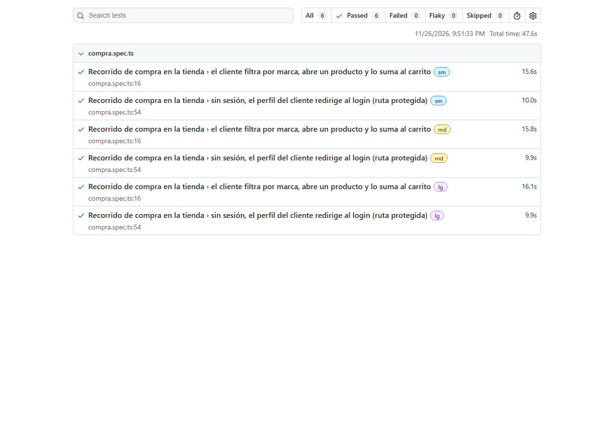

# Evidencia de la ejecución de las pruebas automáticas (26/11/2026)

[Volver a Pruebas](README.md)

| | |
| :-- | :-- |
| Fecha | 26/11/2026 |
| Rama | `entrega-tp-final` (sobre el commit `fa8c51b` de `main`, con los cambios de esta entrega sin commitear) |
| Entorno | Windows 11, Node.js 22.21.1, Angular 21.2.26, Deno 2.9.8, Supabase CLI 3.4.0 (pila local en Docker), Vitest 4.1.12, Playwright 1.65.1 |

## Resumen

| Conjunto | Comando | Resultado |
| :-- | :-- | :-- |
| Unitarias de componentes (frontend) | `npm run test:fe` | 2 archivos, **7 de 7** correctas |
| End-to-end (frontend) | `npm run test:e2e` | **6 de 6** correctas (2 pruebas en SM, MD y LG) |
| Integración (backend) | `npm run test:integracion` | **1 de 1** correcta (9 pasos) |
| Unitarias y de concordancia (backend) | `npm run test:funciones` | **151 de 151** correctas, en 14 archivos |
| Base de datos (pgTAP) | `npm run test:db` | 2 archivos, **11 de 11** correctas |
| Compilación de producción | `cd fe && npx ng build` | Correcta, con las 2 páginas legales pre-renderizadas |

## Unitarias de componentes (Vitest)

```text
 RUN  v4.1.12 D:/Documentos/Proyectos/Laelsi/fe

 ✓  Frontend  src/app/pages/admin/components/table-components/entity-state-badge/entity-state-badge.component.spec.ts > EntityStateBadgeComponent > Activo es verde 52ms
 ✓  Frontend  src/app/pages/admin/components/table-components/entity-state-badge/entity-state-badge.component.spec.ts > EntityStateBadgeComponent > Pausado es ámbar 8ms
 ✓  Frontend  src/app/pages/admin/components/table-components/entity-state-badge/entity-state-badge.component.spec.ts > EntityStateBadgeComponent > Inactivo es rojo 6ms
 ✓  Frontend  src/app/pages/admin/components/form-actions/form-actions.component.spec.ts > FormActionsComponent > muestra los textos recibidos por input 76ms
 ✓  Frontend  src/app/pages/admin/components/form-actions/form-actions.component.spec.ts > FormActionsComponent > deshabilita el botón de envío con submitDisabled 8ms
 ✓  Frontend  src/app/pages/admin/components/form-actions/form-actions.component.spec.ts > FormActionsComponent > sin cancelUrl, el clic en Cancelar emite cancelClick 8ms
 ✓  Frontend  src/app/pages/admin/components/form-actions/form-actions.component.spec.ts > FormActionsComponent > con cancelUrl, el clic en Cancelar navega y no emite 7ms

 Test Files  2 passed (2)
      Tests  7 passed (7)
```

## End-to-end (Playwright)

```text
> fe@0.0.0 e2e
> playwright test

Running 6 tests using 6 workers

  ✓  2 [md] › e2e\compra.spec.ts:54:3 › Recorrido de compra en la tienda › sin sesión, el perfil del cliente redirige al login (ruta protegida) (9.9s)
  ✓  1 [lg] › e2e\compra.spec.ts:54:3 › Recorrido de compra en la tienda › sin sesión, el perfil del cliente redirige al login (ruta protegida) (9.9s)
  ✓  3 [sm] › e2e\compra.spec.ts:54:3 › Recorrido de compra en la tienda › sin sesión, el perfil del cliente redirige al login (ruta protegida) (10.0s)
  ✓  6 [sm] › e2e\compra.spec.ts:16:3 › Recorrido de compra en la tienda › el cliente filtra por marca, abre un producto y lo suma al carrito (15.6s)
  ✓  5 [md] › e2e\compra.spec.ts:16:3 › Recorrido de compra en la tienda › el cliente filtra por marca, abre un producto y lo suma al carrito (15.8s)
  ✓  4 [lg] › e2e\compra.spec.ts:16:3 › Recorrido de compra en la tienda › el cliente filtra por marca, abre un producto y lo suma al carrito (16.1s)

  6 passed (47.6s)
```

Los tiempos incluyen el arranque de `ng serve`, que Playwright levanta antes de las pruebas.

Reporte HTML de Playwright:



## Integración del backend (Deno + pila local de Supabase)

```text
> test:integracion
> npx supabase status -o env > supabase/.env.integracion && deno test --env-file=supabase/.env.integracion --allow-net --allow-env --allow-read supabase/tests/integracion/

running 1 test from ./supabase/tests/integracion/categorias_integracion_test.ts
Integración: CRUD de categorías con autenticación y niveles de acceso ...
  sin token, crear una categoría devuelve 401 ... ok (196ms)
  un Client no puede crear categorías (403) ... ok (51ms)
  sin nombre, la validación responde 400 con el mensaje ... ok (14ms)
  con un estado inválido responde 400 ... ok (19ms)
  el Admin crea la categoría (201) ... ok (37ms)
  la categoría quedó guardada y se lee por la ruta pública ... ok (9ms)
  el Admin la edita y el cambio persiste ... ok (32ms)
  un Client no puede borrarla (403) ... ok (14ms)
  el Admin la borra y deja de existir (404) ... ok (38ms)
Integración: CRUD de categorías con autenticación y niveles de acceso ... ok (1s)
ok | 1 passed (9 steps) | 0 failed (1s)
```

## Unitarias y de concordancia del backend (Deno)

```text
running 2 tests from ./supabase/functions/_tests/bundle_liviano_test.ts
running 17 tests from ./supabase/functions/_tests/cache_publica_unit_test.ts
running 11 tests from ./supabase/functions/_tests/campos_usuario_unit_test.ts
running 14 tests from ./supabase/functions/_tests/estado_usuario_unit_test.ts
running 13 tests from ./supabase/functions/_tests/interfaz_accesible_test.ts
running 17 tests from ./supabase/functions/_tests/interfaz_adaptable_test.ts
running 9 tests from ./supabase/functions/_tests/interfaz_sin_emojis_test.ts
running 5 tests from ./supabase/functions/_tests/navbar_barra_o_menu_movil_test.ts
running 15 tests from ./supabase/functions/_tests/portada_unit_test.ts
running 11 tests from ./supabase/functions/_tests/profundidad_categorias_unit_test.ts
running 18 tests from ./supabase/functions/_tests/publicacion_unit_test.ts
running 11 tests from ./supabase/functions/_tests/subarbol_categorias_unit_test.ts
running 6 tests from ./supabase/functions/_tests/tarjeta_producto_unit_test.ts
running 2 tests from ./supabase/functions/_tests/tienda_sin_formularios_test.ts

ok | 151 passed | 0 failed (2s)
```

El detalle prueba por prueba sale con `npm run test:funciones`.

## Base de datos (pgTAP)

```text
> test:db
> npx supabase test db

Target: local stack (127.0.0.1:54322)
/Documentos/Proyectos/Laelsi/supabase/tests/database/010_estado_de_usuarios.test.sql .. ok
/Documentos/Proyectos/Laelsi/supabase/tests/database/011_estado_pausado.test.sql ...... ok
All tests successful.
Files=2, Tests=11,  1 wallclock secs ( 0.02 usr  0.01 sys +  0.01 cusr  0.01 csys =  0.05 CPU)
Result: PASS
```

## Compilación de producción

```text
Prerendered 2 static routes.
Application bundle generation complete. [15.911 seconds]
▲ [WARNING] bundle initial exceeded maximum budget. Budget 700.00 kB was not met by 83.13 kB with a total of 783.13 kB.
Output location: D:\Documentos\Proyectos\Laelsi\fe\dist\frontend
```

La compilación termina bien. La advertencia de presupuesto indica que el paquete inicial (783 kB sin comprimir, unos 191 kB transferidos) supera el límite de 700 kB configurado en `angular.json`. Es un aviso, no un error.
